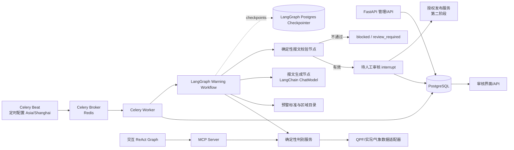
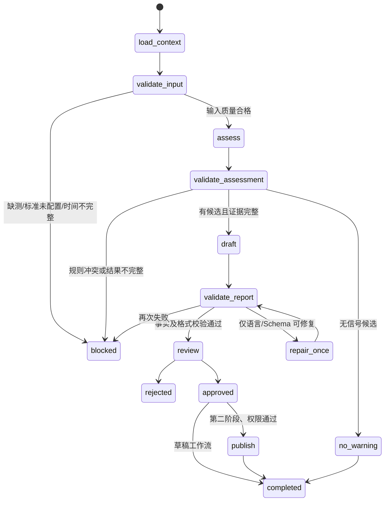

# 气象预警信号 Agent 架构与实施方案

调研基准：2026-10-10。本文结合当前 `mini_agent`（Stage 1 / Iteration 5B3）、Gitee `weather-ai-agent`（master HEAD `a72784f`）及 LangChain/LangGraph、Anthropic、OpenAI、Celery、Temporal 的公开文档与代码。

## 1. 结论与推荐

可以复用两边的实现，但应把它们放在不同层：

| 项目 | 复用定位 | 适合复用 | 不应直接承担 |
|---|---|---|---|
| `weather-ai-agent` | 预警业务应用的宿主与数据适配层 | FastAPI、LangGraph、MCP、QPF 数据客户端、行政区映射和现有统计计算 | 当前 ReAct Agent 不能直接成为无人值守的预警发布流程；现有统计输出不是完备的结构化判别结果 |
| `mini_agent` | Agent Runtime 学习原型和工程参考 | Provider 边界、工具 Schema、权限、运行事件、摘要式审计、受限恢复设计 | 不建议把 coding 工具、workspace snapshot、patch、shell 权限和恢复状态机整体搬入气象业务；它没有 scheduler、worker、subagent 或业务数据库 |
| LangChain / LangGraph | 预警业务编排核心 | StateGraph、节点重试、Postgres checkpointer、interrupt 人工审核、子图/子 Agent | 不负责替代业务规则、标准版本管理、任务调度集群和业务审核数据库 |
| Celery Beat + Worker | 定时触发与后台任务分发 | Cron/interval 触发、队列、重试、并发 worker、任务隔离 | 不提供业务幂等的自动保证；任务投递与执行仍需业务去重和状态账本 |
| PostgreSQL | 业务事实与状态账本 | 候选结果、证据、草稿、校验、审批、发布记录、任务去重；也可使用 LangGraph PostgreSQL checkpointer | 不要只把 Graph checkpoint 当正式业务报文库 |

建议架构：**Celery Beat 创建定时任务，Celery Worker 执行 LangGraph 预警工作流，PostgreSQL 保存业务实体和 checkpoint；判别代码以结构化 Python 服务提供，MCP 只是该服务的交互式工具适配器。** 首阶段只生成待审草稿。报文子 Agent 只能组织已确认事实，不能判级、扩区或发布。

## 2. 当前实现基线

### 2.1 `weather-ai-agent`

最新公开代码具有以下基础：

- `agent/graph.py` 通过 `create_react_agent` 建立一个通用 ReAct Agent。
- `agent/app.py` 只提供 `/chat`、`/health` 与静态前端；启动时装配一个共享 Agent，没有业务任务 API 或调度服务。
- `agent/mcp_bridge.py` 把 MCP Server 的工具转成 LangChain 工具；四个工具面向交互查询。
- `mcp_server/tools/qpf_stats.py` 的 `run()` 接收一个通用降水阈值、时长、区域粒度和 Top N，计算未来 QPF，最后拼成中文文本。
- `regions.yaml` 提供行政区信息；当前部署以一个 Uvicorn worker 运行，Docker Compose 中只有 Agent 服务。
- 测试覆盖 QPF 工具的 mock 冒烟、区域选择和短临分级；尚未看到预警信号规则、报文校验、人工审核、任务去重或正式发布流程。

`count_regions_by_rainfall` 是“某个自定义阈值以上区域统计”，不是完整预警信号判别器。它没有 signal type/level/standard ID/版本/规则命中项等字段，也只输出文本。现代码的 `_cumulate()` 会忽略 `None` 后累加有效时次；在有部分时段缺测时，累计结果可能被低估并仍参与阈值比较。预警场景必须显式返回时次覆盖率、缺测段和质量状态，未达到完整性门槛时停止判别或标记待确认。

另外，已有系统提示词允许把统计阈值解释成积涝、山洪等风险语句；正式预警信号工作流要把这些语句约束到经过批准的规则/指南数据，不要由模型根据自由文本推断。

### 2.2 `mini_agent`

本地代码是一次性 `Agent.run()` 循环，提供 Provider adapter、工具注册与 JSON Schema 参数校验、权限策略、SQLite append-only 运行事件、Artifact/Snapshot 和受限恢复。README 明确其真实 Provider 的工具注册表是 coding 专用，暴露 patch/diff/test。它适合参考 Runtime 边界和审计思路，不是可直接部署的业务 Agent 产品，也没有定时调度、队列、长期业务状态、用户审核 UI 或 subagent 原语。

## 3. 设计原则

1. **规则系统决定预警事实，LLM 只负责表达。** 灾种、级别、区域、统计时段、阈值、起止时间、标准版本和规则命中必须来自确定性判别结果。
2. **先结构化，再生成文本。** 统计服务返回稳定的 Pydantic/JSON 合同；模型不直接解析长段自然语言统计文本来决定报文。
3. **每个定时运行有账本和幂等键。** Celery 至少一次投递、超时重试和 worker 重启都可能重复触发；数据库唯一约束负责去重。
4. **校验器决定草稿能否进入审核。** LLM 返回 JSON Schema 合法不等于事实正确；需要程序逐字段与判别结果、区域表、规则版本核对。
5. **将审批做成可恢复的人机流程。** LangGraph interrupt 可暂停在待审节点，审批后用同一个 `thread_id` 恢复；审批人、决策、时间和草稿版本要写入业务表。
6. **发布是独立、受控的业务动作。** 第一期不开放发布工具。将来发布只能由授权服务在审批记录通过后执行，使用发布幂等键并记录外部回执。
7. **语言模型可替换，判别服务不依赖模型。** 统计规则和历史案例评估可独立测试，换模型不改变预警判级。

## 4. 目标架构



**职责分界：**

- Celery Beat 负责“什么时候创建任务”，只放轻量 task dispatch，不拉取气象数据、不调用 LLM。
- Celery Worker 负责接收任务、检查唯一键、创建/恢复 Graph run、记录成功失败。
- LangGraph 负责一次预警流程的状态和节点编排。每个业务批次使用稳定的 `thread_id`，比如 `warning:{schedule_id}:{window_start}:{window_end}:{rule_version}`。
- 判别服务负责数据拉取、缺测检查、阈值和级别判定、区域映射，输出结构化 `WarningAssessment`。
- MCP 交互工具和计划任务工作流调用同一业务服务，不互相调用对方的 Agent。计划任务不依赖 LLM 来选择“应该调用哪个统计工具”。
- 报文子 Agent/节点只接收经过校验的事实对象和适用指南文本，不持有判别工具、通用网络工具、shell 或发布权限。
- PostgreSQL 业务表是任务、结果、草稿、审核和发布状态的权威记录；LangGraph checkpointer 保存流程续跑状态。两者可以共用 PostgreSQL 服务，但分 schema、权限与生命周期。

## 5. LangGraph 工作流设计

不要把正式预警做成一个自由漫游的 ReAct Agent。用显式 StateGraph 固化节点顺序；仅“报文表达”节点调用 LLM。



推荐节点：

| 节点 | 类型 | 责任 |
|---|---|---|
| `load_warning_input` | 确定性 | 固化数据时间窗、运行配置、规则版本和上游数据源标识 |
| `check_input_quality` | 确定性 | 数据完整性、时次覆盖、单位、时间一致性；不合格转 `blocked` |
| `run_assessment` | 确定性 | 调用已注册规则引擎，输出候选信号和逐区域证据 |
| `validate_assessment` | 确定性 | 对等级、阈值、区域、标准版本和质量状态执行断言 |
| `build_report_facts` | 确定性 | 选择已批准的模板和防御指南 ID，生成白名单事实包 |
| `generate_report_draft` | LLM | Structured Output 生成报文段落/标题字段，不得输出新事实 |
| `validate_report` | 确定性 | 比较所有事实字段、数字、单位、区域、时间、指南版本；验证规范格式 |
| `await_human_review` | interrupt | 暂停图并展示草稿、证据摘要、规则版本和校验报告 |
| `record_review` | 确定性 | 写审批人、决定、备注、草稿版本、时间；拒绝则归档或退回修改 |
| `publish_report` | 第二阶段 | 仅在授权、批准、草稿 hash 未变化时调用现有发布系统 |

如果报文由固定字段和固定句式构成，建议第一版不需要专门的多 Agent supervisor：用一个受约束的生成节点就足够。只有未来出现多个独立报告域（暴雨、台风、大风）且各自有大量知识和工具时，才把它们封装为 LangGraph subgraph/Agent-as-tool。这里的“报文子智能体”是职责隔离的子图，不代表让它重新决策整条业务流程。

## 6. 关键数据合同

### 6.1 `WarningAssessment`

```json
{
  "assessment_id": "uuid",
  "batch_id": "uuid",
  "hazard_type": "rainstorm",
  "candidate_level": "yellow",
  "status": "candidate",
  "issue_time": "2026-10-10T09:00:00+08:00",
  "valid_from": "2026-10-10T09:00:00+08:00",
  "valid_to": "2026-10-10T12:00:00+08:00",
  "standard": {"id": "zhejiang-warning-signals", "version": "approved-version"},
  "rule": {"id": "rainstorm-yellow", "version": "1.0.0", "threshold": 35.0, "unit": "mm", "period_minutes": 180},
  "data_quality": {"complete": true, "expected_steps": 36, "valid_steps": 36, "missing_regions": [], "source_issue_time": "2026-10-10T08:00:00+08:00"},
  "regions": [
    {"region_id": "3301...", "canonical_name": "示例乡镇", "parent_id": "3301...", "observed_value": 38.2, "unit": "mm", "period_minutes": 180, "rule_hit": true, "evidence_ref": "sha256:..."}
  ],
  "summary": {"candidate_region_count": 1, "eligible_region_count": 193},
  "evidence_refs": ["sha256:..."],
  "created_at": "2026-10-10T09:02:00+08:00"
}
```

例子里的阈值仅说明合同形状，不是业务建议阈值。阈值和等级必须按业务部门确认的浙江/杭州现行标准、实际使用的预报要素和发布规范配置。不要把现有 QPF 通用阈值直接映射成官方预警等级。

### 6.2 `WarningReportDraft`

```json
{
  "draft_id": "uuid",
  "assessment_id": "uuid",
  "title": "规范模板填充结果",
  "signal_name": "由程序按标准映射",
  "level": "由 assessment 带入",
  "area_ids": ["canonical region ids"],
  "area_text": "由规范区域表生成",
  "reason_text": "模型仅重组证据中的数字、时间与描述",
  "defense_guide_id": "approved-guide-id",
  "body": "完整草稿正文",
  "fact_refs": ["assessment field paths / evidence ids"],
  "model_id": "provider:model-version",
  "prompt_version": "warning-report-v1",
  "validator_version": "warning-validator-v1",
  "validation": {"passed": true, "errors": []},
  "content_sha256": "..."
}
```

`title/signal_name/level/area_text/validity/guide` 尽量由程序从标准、规则和目录填充；模型生成可语言化的原因说明和模板中允许的连接语。建议存为字段对象，最后由确定性 renderer 组合为发布报文，避免模型生成的 JSON 再混杂不可验证的自然语言字段。

## 7. 准确性与阻断逻辑

报文能否进入审核，至少要通过以下硬校验：

- 灾种、预警等级、区域 ID、起止时间严格等于 `WarningAssessment`；模型不能更改。
- 所有数字和单位均来自 assessment 的证据字段；涉及数字的语句必须能映射到 `fact_refs`。
- 区域名称来自规范区域目录；别名需先由确定性区域匹配转成 canonical ID。
- 阈值、时长、有效期、防御指南 ID 与标准版本相容；当前生效标准缺失就停止。
- 数据完整性不达标时不进行确定性等级判定。不可将“忽略缺测后相加”的估算值当完整观测/预报值。
- 同一批次同一标准版本的结果可重放：记录上游起报时间、输入快照 hash、规则包版本和版本化区域目录。
- LLM 生成之后最多允许有限的一次格式修复；事实不一致、未知信息或校验再次失败时直接进入 `review_required/blocked`，不能无限循环。
- 评估集包含历史已发布案例、无信号案例、多个等级边界、边界值前后、跨区县、区域别名、缺测、延迟数据、单位错配、标准切换和重复批次。

需要同时统计两组指标：

| 判别指标 | 报文指标 |
|---|---|
| 按灾种/等级的准确率、召回率和混淆矩阵 | 事实字段一致率、区域准确率、数值引用准确率 |
| 阈值边界一致性 | 必填段落完整率、格式通过率 |
| 缺测/延迟输入的正确阻断率 | 无依据事实率（目标为 0） |
| 每个区域的误报/漏报率 | 人工修改率、人工退回率、审核耗时 |

正式指标门槛要由业务专家基于历史样本确定；发布前应按灾种、等级分层复核，而不能只看整体平均分。

## 8. 定时任务、去重与失败恢复

### 8.1 运行机制

- Celery Beat 使用明确时区 `Asia/Shanghai` 计算业务触发点；持久化层统一存 UTC 时间戳，同时保留原始业务时区与预定本地时间。
- Beat 每次触发发出 `schedule_id + scheduled_for + rule_version`，任务本身不携带大体积气象数据。
- Worker 先在 PostgreSQL 写入 `scheduled_run`，通过唯一约束 `(schedule_id, scheduled_for, rule_version)` 防止重复创建，再启动 LangGraph。
- Celery 任务设置 `acks_late` 等参数前，先确认业务节点幂等；消息重投不能造成重复草稿或发布。
- 同一灾种、区域集合和有效时间窗的任务可配置 `max_active_runs=1`。若上一周期尚未完成，策略是跳过、排队或合并必须显式决定，不能隐式并发。
- LLM/API 失败仅在幂等节点边界按错误类别退避重试；业务规则错误、校验失败、标准缺失不是可重试异常。
- 每个 Graph run 使用稳定 `thread_id`，Postgres checkpointer 支持从 interrupt 或异常检查点恢复；业务状态仍写入业务表。
- 定时任务状态建议为 `queued -> running -> assessed -> draft_ready -> review_required -> approved/rejected -> published/completed`，失败路径为 `retry_wait/blocked/failed`。

### 8.2 Scheduler 技术选择

推荐在当前部署形态上采用 **Celery Beat + Celery Worker + Redis broker + PostgreSQL 业务库**。Celery 是成熟的 Python 任务队列；Beat 与 API/Worker 分开部署，Beat 保持单活。Celery 官方文档说明周期任务可能重叠，需自行用锁/任务约束避免冲突，因此数据库唯一键和 active-run 锁仍是必要的。

如果系统长期只有单节点、只有少量固定任务，独立 APScheduler 进程配 PostgreSQL 运行账本可以作为更小的首个试点；不要把 scheduler 嵌进 FastAPI lifespan 后再用多个 Uvicorn worker 或副本，因为每个进程都可能重复触发。生产多节点时用队列与独立 Beat，或采用 Temporal Schedules/Workflow 作为更强的持久工作流平台。Temporal 的代价是增加服务端和运维栈；不建议仅为第一版报文草稿立即引入。

LangSmith Deployment 的 Crons 是 LangChain 官方托管/部署体系提供的运行能力，文档还说明 cron 使用 UTC；它不是当前自托管 Docker Compose 中开箱即用的纯开源 scheduler。因此这里选外部开源调度层，不把 LangGraph 本身当 scheduler。

## 9. 数据表建议

最小业务表：

- `warning_schedules`: 灾种、范围、cron/间隔、时区、生效区间、规则版本、启停状态、配置版本。
- `warning_runs`: `run_id`、schedule、预定时间、数据起报时间、状态、唯一幂等键、attempt、错误码、Graph thread ID。
- `warning_assessments`: 判别 JSON、规则版本、标准版本、输入快照引用、数据质量、区域证据。
- `warning_report_drafts`: 结构化字段、最终正文、model/prompt/validator 版本、内容 hash、当前版本。
- `warning_reviews`: reviewer、decision、comment、draft hash、decision time；追加式，不覆盖既有决定。
- `warning_publications`: 发布请求幂等键、批准的 draft hash、外部回执、发布时间、操作者。
- `warning_audit_events`: 业务状态变化和关键决策，敏感数据最小化；与 mini_agent 的 append-only Journal 思路一致。

LangGraph checkpointer 单独用官方 Postgres saver 管理。对于同一个运行，业务表记录结果身份与生命周期，checkpoint 只负责工作流暂停/续跑。

## 10. 代码组织建议

在 `weather-ai-agent` 内增量演进：

```text
warning/
  domain.py                 # Pydantic WarningAssessment / ReportDraft
  service.py                # 不依赖 LangChain/MCP 的统计与规则服务
  rules/                    # 按地区/标准版本加载的确定性规则
  repositories.py           # Postgres 业务表访问
  validators.py             # assessment / report 硬校验
  renderer.py               # 已校验结构对象到正式报文模板
agent/
  graphs/interactive.py     # 保留当前聊天 ReAct graph
  graphs/warning_report.py  # 显式 StateGraph 预警工作流
  prompts/warning_report.py  # 仅报文表达 prompt，版本化
  tools/warning.py          # MCP tool adapter，映射到 warning.service
workers/
  celery_app.py
  tasks.py                  # dispatch_warning_run / resume_warning_run
```

关键重构是让 `qpf_stats` 和以后预警统计共享一个返回 `WarningAssessment` 或基础统计 DTO 的服务。MCP 工具继续对交互用户返回可读文本，但定时工作流拿类型化对象。不要由 Worker 启动一份模型 Agent，再让模型按自然语言调用 MCP 来执行确定性统计。

## 11. 与两项目的复用矩阵

| 当前能力 | 处理方式 | 原因 |
|---|---|---|
| weather 的 `HzqxClient`、PNG 解码、插值、区域选择 | 复用并增加数据质量与来源元数据 | 这是已有气象数据能力 |
| `qpf_stats.run()` 统计主计算 | 保留算法，拆分纯业务函数和表现层 | 返回结构对象供批任务使用；MCP 再格式化为文本 |
| weather `create_react_agent` | 保留给用户自由问答；新建显式 warning graph | 业务流程节点和审批关口必须确定 |
| MCP Server | 保留；新增 `get_warning_context` 或查询工具 | MCP 是工具协议/适配层，不是任务调度层 |
| FastAPI | 复用并增加 schedule/run/draft/review API | 仍是外部控制平面与 UI 后端 |
| mini_agent Provider abstraction | 参考边界，不照搬实现 | weather 已经用 LangChain ChatModel；避免维护双套模型运行时 |
| mini_agent SQLite Journal | 借鉴 append-only、敏感内容摘要策略 | 业务需要 Postgres 和可查询的领域记录；不应记录完整报文在只存摘要的 Journal |
| mini_agent permission policy | 借鉴工具权限分层 | 发布权限应由业务身份/审批服务控制，而不是 coding-agent 本地审批策略 |
| mini_agent Snapshot/Recovery | 借鉴恢复与幂等原则 | LangGraph Postgres checkpointer 已提供工作流 checkpoint，避免重复建设通用 snapshot |

## 12. 分阶段实施

### 阶段 A：统计合同与离线评估

- 将统计核心改为结构化输出，增加每区域有效时次、覆盖率、缺测点、输入起报时间和来源引用。
- 先确定实际业务使用的灾种、标准文档版本、每个等级规则、区域发布粒度和时间窗口。
- 修复部分缺测被当完整累计值的问题；添加完整/部分/全部缺失三类测试。
- 建立历史个例 golden dataset，运行旧判别结果与专家结果对照，记录误报/漏报。

### 阶段 B：人工触发报文草稿

- 新增 `WarningAssessment`、`WarningReportDraft`、规则版本和校验器。
- 新建 LangGraph warning workflow：assessment -> validation -> draft -> validation -> interrupt review。
- 持久化使用 PostgreSQL checkpointer；业务表保留 assessment、draft 和 reviewer 决策。
- 增加只读管理 API 查询 run、draft、校验差异；此阶段不安排发布动作。

### 阶段 C：定时自动生成草稿

- 加 Celery Beat 和 worker 容器、Redis broker、PostgreSQL 迁移/备份配置。
- 增加任务唯一键、单活策略、过期窗口处理、重试分类、告警和死信/人工恢复入口。
- 运行 shadow mode：定时生成但不推送审核队列，由人工与现行业务并行核对。
- 经过历史回放和连续运行验收后，再启用正式待审核队列。

### 阶段 D：受控发布

- 先接入现有授权发布平台，不把发布凭据暴露给报文子 Agent。
- 审核批准必须绑定精确 `draft_id + content_sha256 + standard_version`；任何草稿修改使审批失效。
- 先做人工点击发布；确认外部平台回执、撤回/更正路径、超时结果查询和幂等后，评估是否增加受限自动发布策略。
- 所有正式发布策略、灾种和等级需由业务负责人明确批准。

## 13. 测试与上线门槛

- **规则单测**：每个阈值 `< / = / >` 边界、单位换算、周期和跨周期数据、多个候选等级优先级。
- **数据质量测试**：一条缺失、连续缺失、整区域缺测、延迟/乱序、起报时间冲突、极端值、NaN。
- **区域合同测试**：别名、重名、区县/乡镇层级、全域集合、行政区代码更新。
- **生成校验测试**：模型擅自改等级、补新数字、扩大区域、改时间、写错指南版本都应失败。
- **工作流恢复测试**：interrupt 后审批恢复、worker 在节点前后退出、重复 Celery 消息、同一批次重复触发、失败重试。
- **并发测试**：两个 worker 同时领取同一 schedule window，只能创建一条有效 run/draft。
- **shadow mode**：至少覆盖业务专家选定的历史典型个例、边界案例和缺测案例；验收门槛应在测试前书面确定。
- **运行监控**：调度延迟、数据时效、缺测率、规则异常、LLM 超时、blocked 数、待审积压、审核时延、草稿修改率和重复任务数。

## 14. 需业务方确认的规则输入

架构可以先按上述合同搭建，真正判定仍需要业务标准确认。实施前要把以下内容纳入版本化配置：

- 哪些灾种、哪些预报/实况要素触发信号；统计时段和时间窗如何滚动。
- 地方标准与国家规范的适用优先级、当前有效版本和生效日期。
- 区域范围按市、区县、乡镇还是具体站点发布，跨区如何合并或拆分。
- 数据缺测比例、来源延迟和多产品冲突时的阻断/降级策略。
- 标题、正文、解除/变更报文的规范模板及各级防御指南来源。
- 计划运行频率、任务重叠策略、需要自动生成的工作时段。
- 审核角色、驳回后重生成机制，以及既有发布平台的 API、审批和撤回机制。

## 15. 调研来源

所有来源访问日期为 2026-10-10。官方文档可能随版本更新；落地时应按项目锁定的依赖版本复核 API。

### 当前代码

- [weather-ai-agent Gitee 仓库](https://gitee.com/hu_jiayue/weather-ai-agent)（调研时 master HEAD `a72784f`）
- [mini_agent GitHub 仓库](https://github.com/fourmia/my_own_agent)（本地 develop 分支现有实现）

### LangChain / LangGraph

- [LangGraph persistence](https://docs.langchain.com/oss/python/langgraph/persistence)：checkpointer、thread-scoped state、store 与持久化选择。
- [LangGraph interrupts](https://docs.langchain.com/oss/python/langgraph/interrupts)：interrupt、checkpoint 和同一 `thread_id` 恢复；重入节点要注意副作用幂等。
- [LangGraph subagents](https://docs.langchain.com/oss/python/langchain/multi-agent/subagents)：subagent 作为工具调用、上下文隔离、同步/异步选择。
- [LangGraph fault tolerance](https://docs.langchain.com/oss/python/langgraph/fault-tolerance)：节点 retry policy、backoff 和错误处理。
- [LangSmith Deployment cron jobs](https://docs.langchain.com/langsmith/cron-jobs)：LangChain 部署产品提供的 cron 功能，时间按 UTC 解释；用于区分托管产品能力与本方案的开源自托管调度。
- [LangGraph GitHub](https://github.com/langchain-ai/langgraph)：核心开源仓库。

### Agent 工程参考

- [Anthropic: Building effective agents](https://www.anthropic.com/engineering/building-effective-agents)：以简单、可组合的 workflow 起步；按任务需要决定何时引入更自治的 agent；用工具定义和评估逐步提升可靠性。
- [OpenAI Agents SDK Python](https://github.com/openai/openai-agents-python)：Agents、工具、handoff、guardrails、trace 等结构化 Agent 设计参考。本文只借鉴工程模式，不建议在已有 LangGraph 项目再引入第二套 Agent orchestration runtime。

### 调度与工作流

- [Celery periodic tasks](https://docs.celeryq.dev/en/stable/userguide/periodic-tasks.html)：Beat 调度、时区设置、数据库调度存储，以及周期任务可能重叠的提示。
- [Temporal Schedules](https://docs.temporal.io/schedule)：独立持久 Schedule 启动 Workflow Execution 的模式，可作为未来更强持久工作流选项；部署复杂度高于 Celery。
