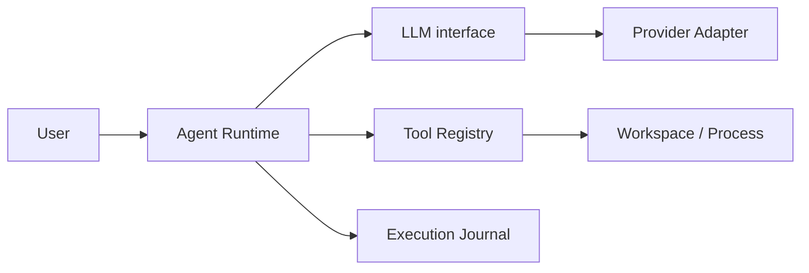
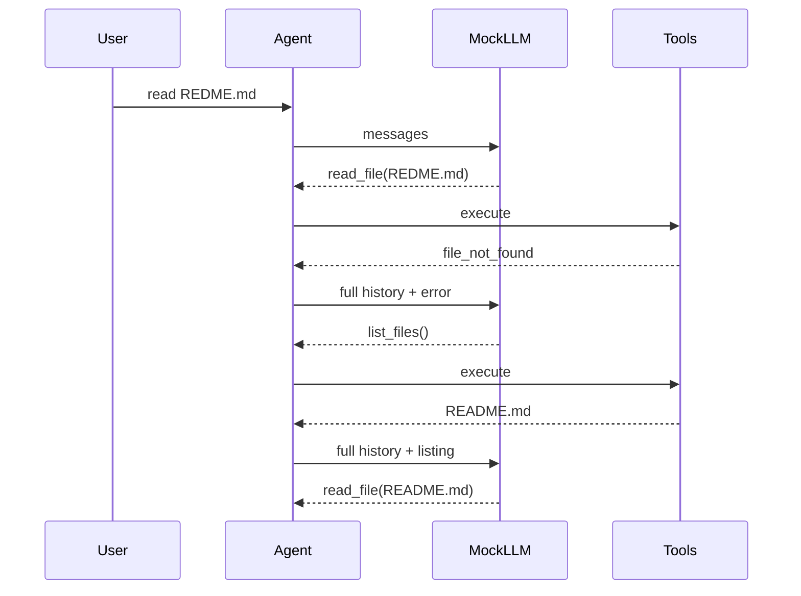
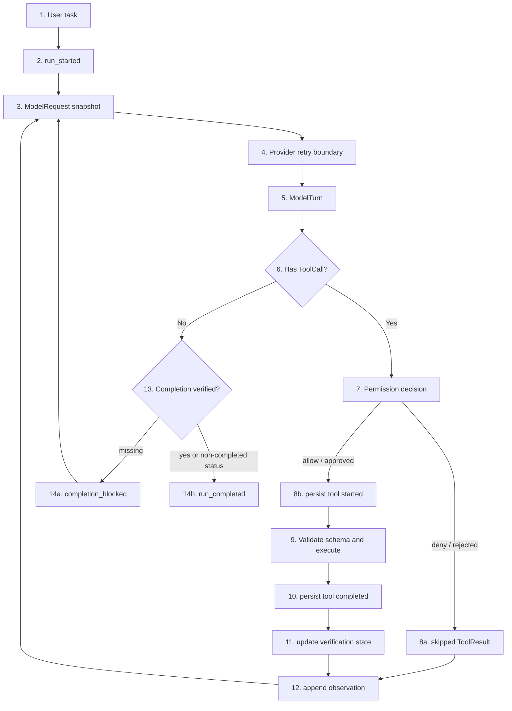

# Mini Agent 从零实现指南：从 Agent Loop 到可分析恢复

这是一份面向新手的主线教程。它不假设你已经理解 Agent、Tool Calling、Provider Adapter、权限策略或事件日志，只要求你能阅读基础 Python。

本教程从项目最早的最小循环讲到当前 Iteration 5B1。读完后，你应该不仅知道“每个文件做什么”，还应该能解释：为什么必须按这个顺序迭代、每一层解决了什么失败模式，以及哪些设计会严重影响 Agent 的准确度。

> 本文讲的是当前代码的真实实现。早期专题文档保留了当时的演进过程，个别早期字段已经被后续版本升级；遇到差异时，以当前源码和本文为准。

## 如何使用这份教程

不建议一次读完。按下面五次学习，每次都运行对应命令或测试：

| 学习次数 | 阅读范围 | 目标 |
| --- | --- | --- |
| 第一次 | 第 1～3 节 | 建立 Agent、Runtime、Tool 和消息循环的直觉 |
| 第二次 | 第 4～5 节 | 理解 Schema、信任边界、错误 observation 和恢复 |
| 第三次 | 第 6～7 节 | 理解领域协议、call ID 和真实 Provider Adapter |
| 第四次 | 第 8 节 | 理解权限、受控修改、重试边界和完成验证 |
| 第五次 | 第 9～17 节 | 理解 Journal、Snapshot、恢复分析、准确度因素和扩展方法 |

每次学习采用相同方法：

1. 先读“为什么”，暂时跳过不熟悉的语法。
2. 运行本节命令，观察 trace 或测试结果。
3. 再打开文中指出的源码和测试。
4. 不看文档回答本节的“掌握标准”。
5. 如果答不出来，回到对应测试，从输入和断言反推协议。

第一次阅读时不需要理解 OpenAI SDK 的每个字段，也不需要记住所有事件类型。优先抓住一个问题：每一层接收什么可信度的数据，返回什么合同，出错后由谁决定下一步。

## 1. 先建立全局认识

### 1.1 普通聊天模型与 Agent 的区别

普通聊天模型的基本过程是：

```text
用户输入 -> 模型生成文本 -> 返回文本
```

Agent 多了“观察真实世界并采取动作”的循环：

```text
用户目标
  -> 模型决定下一步
  -> Runtime 判断是否允许
  -> 工具执行真实动作
  -> 工具结果写回历史
  -> 模型依据新证据继续决定
  -> 满足完成条件后结束
```

模型并不直接读取文件，也不直接运行命令。模型只能生成一个结构化的“工具调用意图”，真正的执行权在 Runtime 手里。

例如用户输入：

```text
读取 README.md
```

模型可能返回：

```python
ToolCall(
    call_id="call-1",
    name="read_file",
    arguments={"path": "README.md"},
)
```

`ToolRegistry` 校验参数并读取文件，再把内容作为 `ToolResult` 写回消息历史。模型在下一轮看到真实内容后才生成回答。

### 1.2 本项目中的五个核心边界



| 边界 | 负责什么 | 不负责什么 |
| --- | --- | --- |
| `Agent` | 循环、顺序、历史、停止、权限和日志编排 | 不实现具体模型 API，不直接读写文件 |
| `LLM` | 接收领域请求，返回领域化模型轮次 | 不执行工具 |
| Provider Adapter | 把领域协议映射到某家 SDK | 不决定 Runtime 安全策略 |
| `ToolRegistry` | 注册、校验、执行允许的工具 | 不让模型任意执行 Python 代码 |
| `EventStore` | 持久化执行事实 | 不替模型做决策，也不等于自动恢复 |

边界越清晰，错误越容易定位。比如：

- 模型选错工具，是决策问题；
- 参数 JSON 不合法，是 Provider/Schema 边界问题；
- 路径逃逸，是 Tool Registry 安全问题；
- 工具执行后被网络重试，是 Runtime 重试边界问题；
- 模型说“完成”但没测试，是完成验证问题。

### 1.3 Stage 与 Iteration 的关系

本项目目前仍处于“Stage 1：建立可靠 Agent Runtime”，但在 Stage 1 内进行了多次迭代：

| 阶段 | 核心问题 | 新增能力 |
| --- | --- | --- |
| 最小 Agent Loop | Agent 怎样循环？ | MockLLM、工具调用、观察、`max_steps` |
| Iteration 1 | 模型参数能信任吗？ | JSON Schema、结构化工具错误 |
| Iteration 2 | 工具失败后怎么办？ | 完整历史、错误分类、有限恢复 |
| Iteration 3A | 怎样支持真实 Provider 和多个调用？ | 领域协议、`call_id`、`ModelTurn` |
| Iteration 3B | 怎样接入 OpenAI？ | Responses Adapter、SDK 错误映射 |
| Iteration 4 | 怎样安全修改并证明完成？ | 重试、权限、受控 Patch、验证守卫 |
| Iteration 5A | 进程结束后怎样知道发生过什么？ | SQLite Journal、中断风险识别 |

这些不是互相替代的版本，而是一层层叠加的能力。

### 1.4 新手词汇表

| 术语 | 在本项目中的意思 |
| --- | --- |
| Agent | 能在“模型决策—工具执行—观察结果”循环中推进任务的系统，不等于单独一个模型 |
| Runtime | 真正控制循环、权限、工具顺序、停止和验证的程序，即当前 `Agent` 所在层 |
| LLM | 大语言模型接口；项目中的 `LLM` 是抽象边界，不代表某一家供应商 |
| Provider | 提供模型 API 的服务，例如 OpenAI |
| Adapter | 把本项目的领域对象转换成某家 Provider 请求/响应的适配层 |
| Tool | Runtime 允许模型请求的一项能力，由描述、参数 Schema 和本地 handler 组成 |
| handler | 真正执行文件读取、Patch 或测试的 Python 函数 |
| Tool Calling | 模型输出结构化工具名和参数，而不是直接执行函数 |
| observation | 工具执行后写回模型历史的事实，包括成功内容或结构化错误 |
| Schema | 数据必须具备哪些字段和类型的机器可验证合同 |
| Policy | 根据规则返回 allow、ask 或 deny 的决策层 |
| State machine | 根据当前状态和事件决定下一状态的明确规则，不是随意的 if 拼接 |
| side effect | 改文件、启动进程等会改变外部世界的行为 |
| idempotency | 同一动作重复执行仍只产生一次等价效果；普通 Patch 和命令通常不能假设幂等 |
| optimistic concurrency | 先读取版本，写入前确认版本没变；本项目用 SHA-256 实现最小形式 |
| journal | 按时间追加的执行事实日志，与提供给模型的 message history 不同 |
| artifact | 体积较大的正文证据，例如 diff、测试输出、文件快照；当前 5A 尚未实现独立存储 |
| fail-closed | 遇到未知协议或不确定状态时拒绝继续，而不是猜测为安全或成功 |

本文偶尔使用“模型思考”这一通俗说法，准确含义是“模型根据输入生成下一轮文本或结构化调用”。Runtime 不应该依赖、解析或假设模型的隐藏推理过程。

### 1.5 阅读源码前需要认识的 Python 写法

项目大量使用以下语言特性：

```python
@dataclass(frozen=True)
class ToolDefinition:
    name: str
    description: str
    parameters: dict[str, Any]
```

`@dataclass` 自动生成初始化、比较和显示方法。`frozen=True` 表示构造后不能普通赋值修改，适合表达一次模型请求或调用这样的“事实值”。它不是深度不可变：字段中如果包含 list 或 dict，其内部仍可能变化，所以 Agent 构造请求时还会显式复制消息列表。

```python
FinishReason = Literal["completed", "tool_calls", "incomplete", "refusal"]
```

`Literal` 表示值只能来自列出的字符串集合，帮助类型检查器和读代码的人理解协议范围。它不会自动校验运行时外部输入，因此 `ModelTurn` 和 Journal 仍然显式检查真实值。

```python
class EventStore(Protocol):
    def append(...) -> RunEvent: ...
    def load(...) -> list[RunEvent]: ...
```

`Protocol` 描述“只要对象提供这些方法，就可以被 Runtime 使用”。`Agent` 不必知道对象是 SQLite Store、内存 Fake 还是未来的远端数据库。

这种把具体对象从外部传给 `Agent` 的方式叫依赖注入：

```python
Agent(
    llm=provider,
    tools=registry,
    permission_policy=policy,
    event_store=store,
)
```

依赖注入让测试可以传入确定性的 Fake，也让 Runtime 不必硬编码某家模型、数据库或审批界面。

## 2. 准备环境与第一次运行

### 2.1 安装

在项目目录执行：

```powershell
python -m pip install -e ".[dev]"
```

项目要求 Python 3.9 或更高版本。核心依赖只有 `jsonschema`；OpenAI SDK 和 pytest 位于可选依赖中。

### 2.2 先使用 MockLLM

```powershell
python -m mini_agent "list files"
python -m mini_agent "read README.md"
python -m mini_agent "stats README.md"
python -m mini_agent "read REDME.md"
```

`MockLLM` 不调用网络。它是一个规则驱动的确定性模型，用来让你先看清 Runtime，而不是先处理 API Key、模型随机性和费用。

运行时会看到类似结构：

```text
[step 1] assistant
I should inspect the requested file.

[step 1] tool_call[mock-call-0001]
read_file({'path': 'README.md'})

[step 1] observation[mock-call-0001]
...真实文件内容...

[step 2] assistant
I observed the tool result: ...
```

CLI 最后还会输出：

```text
[run_id]
run-...
```

这个 ID 是 Iteration 5A 的执行日志关联键。

### 2.3 运行测试

```powershell
python -m pytest -q
```

默认测试不访问真实模型。`tests/test_openai_live.py` 是显式 opt-in 的真实网络测试，默认会跳过。

## 3. 最小 Agent Loop：先让循环成立

### 3.1 这一阶段要解决什么

最小 Agent 不追求聪明，只要正确完成下面的协议：

```text
history -> model -> optional tool calls -> observations -> history -> model
```

最关键的代码入口是：

- `mini_agent/agent.py`：循环控制器；
- `mini_agent/llm.py`：`LLM` 接口与 `MockLLM`；
- `mini_agent/tools.py`：工具注册和执行；
- `mini_agent/schema.py`：系统中流动的数据。

### 3.2 最小循环的伪代码

当前 `Agent` 已经加入后续迭代能力，但骨架仍然可以简化成：

```python
messages = [Message("user", task)]

for step in range(max_steps):
    request = ModelRequest(messages=messages, tools=tool_definitions)
    response = llm.generate(request)
    messages.append(assistant_message(response))

    if not response.tool_calls:
        return response.content

    for call in response.tool_calls:
        result = registry.run(call)
        messages.append(tool_message(result))

return "stopped by max_steps"
```

这里有四条不能破坏的语义：

1. 每次模型请求都携带当前历史。
2. assistant 的工具调用意图必须进入历史。
3. 工具结果必须以 tool 消息进入历史。
4. Runtime 必须有不依赖模型意愿的停止上限。

### 3.3 为什么 observation 必须返回模型

模型调用 `read_file` 时，它只表达了“我想读取”。调用意图不是读取结果。如果 Runtime 不把工具结果放回上下文，下一轮模型无法知道：

- 文件是否存在；
- 读取是否成功；
- 文件的真实内容；
- 是否需要换一种行动。

这会导致最常见的 Agent 幻觉：工具尚未成功，模型却根据自己的预期编造结果。

### 3.4 为什么必须有 `max_steps`

模型可能一直请求同一个工具：

```text
list_files -> list_files -> list_files -> ...
```

策略 Prompt 只能降低概率，不能形成硬边界。`max_steps` 是 Runtime 的确定性安全阀，可以阻止：

- 无限循环；
- 无限 Token 消耗；
- 工具重复执行；
- 错误恢复状态机失控。

对应测试：`tests/test_agent.py::test_agent_stops_at_max_steps`。

### 3.5 本阶段如何影响准确度

| 设计 | 对准确度的影响 |
| --- | --- |
| 工具结果回写历史 | 模型能根据真实证据继续推理 |
| 结构化调用而非自然语言命令 | Runtime 不需要猜模型想执行什么 |
| 完整 assistant/tool 顺序 | 避免 observation 与动作错位 |
| `max_steps` | 错误时安全停止，但过小也会截断正确任务 |

`max_steps` 不是越大越好。太小会让需要多步探索的任务提前停止，太大则放大循环、成本和副作用风险。生产系统通常还会增加 Token、时间、工具调用次数和费用预算。

### 3.6 动手实验

运行：

```powershell
python -m mini_agent "read README.md"
```

观察它为什么需要两次模型轮次：第一轮选择工具，第二轮根据 observation 回答。

掌握标准：你能不用看代码画出 user、assistant、tool、assistant 四条消息的顺序。

## 4. Iteration 1：严格工具契约

### 4.1 为什么模型参数不能直接执行

真实模型可能生成：

```json
{}
```

或者：

```json
{"path": "", "unexpected": true}
```

甚至编造不存在的工具名。如果 handler 直接读取 `args["path"]`，错误会以随机 Python 异常暴露；如果是 Shell 或文件工具，非法参数还可能越过安全边界。

因此模型输出必须被视为不可信输入。

### 4.2 `Tool` 的两个面

当前 `Tool` 同时包含：

```python
@dataclass(frozen=True)
class Tool:
    name: str
    description: str
    parameters: dict[str, Any]
    fn: ToolFn
    permission: ToolPermission = "read"
    effect: ToolEffect = "none"
```

其中：

- `name`、`description`、`parameters` 可以交给模型；
- `fn` 是本地 Python handler，绝不能发送给 Provider；
- `permission` 和 `effect` 是后续安全策略使用的 Runtime 元数据。

`Tool.definition()` 只返回模型可见的 `ToolDefinition`，这就是能力描述与本地执行实现之间的隔离。

### 4.3 JSON Schema 是工具参数协议

`read_file` 的 Schema 大致如下：

```json
{
  "type": "object",
  "properties": {
    "path": {
      "type": "string",
      "minLength": 1
    }
  },
  "required": ["path"],
  "additionalProperties": false
}
```

它表达了：

- 参数必须是对象；
- `path` 必须存在；
- `path` 必须是非空字符串；
- 不允许模型偷偷附带未定义字段。

`ToolRegistry.register()` 先检查 Schema 本身是否合法；`ToolRegistry.run()` 再使用缓存的 validator 检查每次调用。

### 4.4 统一信任边界

工具执行顺序是：

```text
ToolCall
  -> 参数 JSON 是否成功解析
  -> 工具名是否注册
  -> JSON Schema 是否通过
  -> handler 执行
  -> 异常分类
  -> ToolResult
```

所有工具都经过同一个入口，安全规则不会散落在模型 Prompt 或每个 handler 的开头。

### 4.5 结构化失败 observation

失败会转换成稳定 JSON 信封：

```json
{
  "ok": false,
  "call_id": "call-1",
  "tool": "read_file",
  "error": {
    "code": "file_not_found",
    "message": "File not found: REDME.md",
    "details": {"path": "REDME.md"}
  }
}
```

为什么需要稳定 `error.code`？因为模型、测试和评估系统不应该解析易变化的自然语言错误消息。

### 4.6 路径沙箱

文件工具使用：

```python
path = (root / raw_path).resolve()
```

然后确认解析后的路径仍位于 workspace root 中。于是：

```text
README.md       -> 允许
src/app.py      -> 允许
../secret.txt   -> path_escape
```

注意：这只是工作区路径边界，不是完整操作系统沙箱。测试代码或任意 Shell 仍可能访问其他资源，因此后续还需要 capability minimization 和进程隔离。

### 4.7 新增一个工具要改哪些地方

以 `get_file_stats` 为例，一项能力需要贯通：

1. 编写 handler；
2. 定义严格参数 Schema；
3. 注册到 Registry；
4. 让模型知道什么时候选择它；
5. 为工具成功和失败编写测试；
6. 为 Agent 完整链路编写测试。

只写 handler 不代表 Agent 已经具备这项能力。模型选择、参数协议、执行和 observation 必须全部接通。

### 4.8 本阶段如何影响准确度

Schema 质量会严重影响准确度：

- 字段描述模糊，模型更容易选错参数；
- 允许任意额外字段，协议漂移更难发现；
- 多个工具名字和描述过于相似，工具选择准确率下降；
- 错误码不稳定，模型无法形成可靠恢复策略；
- observation 过长，会挤占上下文并干扰后续决策。

对应测试集中在 `tests/test_tools.py`。

掌握标准：你能解释为什么 JSON Schema 既要发给模型，也要在本地重新校验。

## 5. Iteration 2：多轮错误恢复

### 5.1 从“报告失败”到“根据失败行动”

Iteration 1 可以告诉模型 `file_not_found`，Iteration 2 才让模型依据这个错误采取下一步：



### 5.2 为什么历史必须保存结构化 ToolCall

仅保存 assistant 的自然语言“我去读文件”是不够的。恢复时必须知道：

- 调用的工具名；
- 原始参数 `REDME.md`；
- 已经尝试过几次；
- observation 属于哪个调用。

当前 `Message` 同时保存：

```python
role
content
tool_calls
tool_call_id
tool_name
```

自然语言用于模型推理和人类阅读，结构化字段用于准确关联与回放。

### 5.3 错误分类决定恢复策略

| 错误码 | 可以自动恢复吗 | 当前策略 |
| --- | --- | --- |
| `file_not_found` | 有限恢复 | 列文件、找近似候选、重试一次 |
| `invalid_arguments` | 通常可以 | 让模型修正参数 |
| `path_escape` | 不可以绕过 | 停止或请求用户换合法路径 |
| `invalid_encoding` | 当前不可以 | 等待专门二进制工具 |
| `command_timeout` | 风险较高 | 不盲目重复执行 |
| `command_failed` | 依据输出分析 | 必须保持失败语义 |
| `permission_denied` | 不能偷偷绕过 | 调整计划或请求授权 |

“是否重试”不能只看动作失败，还要看失败是否可恢复，以及动作是否可能已经产生副作用。

### 5.4 MockLLM 的确定性恢复状态机

`MockLLM._after_tool()` 会读取最后一条 tool observation，并扫描更早的结构化调用。

文件名恢复策略：

1. 第一次 `read_file` 返回 `file_not_found`；
2. 调用 `list_files`；
3. 比较完整路径和 basename 相似度；
4. 分数至少为 `0.6` 才选择候选；
5. 自动读取最多重试一次。

阈值体现了一个重要原则：证据不足时宁可停止，也不要为了“完成任务”读取无关文件。

### 5.5 两层停止机制

- 模型/策略层停止：没有可信候选，或已经重试过；
- Runtime 层停止：命中 `max_steps`。

策略层提高效率，Runtime 层提供最终保证。两者不能互相替代。

### 5.6 本阶段如何影响准确度

Agent 的准确度不仅是“一次选对工具”的概率，还包括失败后的恢复质量：

- 历史缺失会让模型重复动作；
- 错误码太粗会让模型采用错误恢复策略；
- 自动重试无限制会制造循环；
- 候选阈值太低会操作错误文件；
- observation 中混入缓存、虚拟环境文件会干扰候选选择。

因此 `list_files` 和 `search_files` 会过滤 `.git`、`.mini_agent`、缓存、虚拟环境和安装元数据。

动手实验：

```powershell
python -m mini_agent "read REDME.md"
```

对应测试：

- `test_agent_recovers_from_misspelled_filename`
- `test_agent_stops_when_no_close_filename_exists`
- `test_agent_stops_at_max_steps`

掌握标准：你能解释为什么“重试一次”是业务恢复策略，而 `max_steps` 是 Runtime 安全策略。

## 6. Iteration 3A：Provider 无关领域协议

### 6.1 为什么不能让 Agent 直接依赖 OpenAI SDK 类型

如果 `Agent` 直接处理某家 SDK 的 Response 对象：

- 更换 Provider 会重写 Runtime；
- 单元测试必须伪造复杂 SDK 对象；
- SDK 升级会把变化扩散到整个项目；
- 权限、工具和 Journal 层会被供应商细节污染。

因此 3A 先定义项目自己的领域 Schema，再接真实 Provider。

### 6.2 当前核心领域类型

```text
ToolDefinition  模型可见工具描述
ToolCall        模型请求执行的动作
Message         持久化对话历史中的一条消息
ToolResult      本地工具执行结果
Usage           Token 使用量
ModelRequest    Runtime 发给 LLM 的领域请求
ModelTurn       LLM 返回给 Runtime 的完整一轮
```

### 6.3 `ToolCall.call_id` 为什么关键

模型一轮可能返回多个调用：

```python
ToolCall("call-a", "read_file", {"path": "a.txt"})
ToolCall("call-b", "read_file", {"path": "b.txt"})
```

结果回传时必须知道哪个结果属于哪个调用：

```text
call-a -> A 文件内容
call-b -> B 文件内容
```

工具名不能充当关联键，因为同一轮可以多次调用同一个工具。数组位置也不够稳健，因为 Provider 协议和异步系统需要显式身份。

Runtime 会：

- 拒绝同一 `ModelTurn` 中重复的 `call_id`；
- 拒绝一次 Agent session 内重复使用已经执行过的 `call_id`；
- 在 tool 消息中保存 `tool_call_id`。

### 6.4 `ModelTurn.finish_reason`

结束状态不再用简单的 `done: bool` 表达：

| 状态 | 含义 | Runtime 行为 |
| --- | --- | --- |
| `tool_calls` | 有工具等待执行 | 执行调用并继续下一轮 |
| `completed` | 模型声明正常完成 | 经过完成守卫后返回 |
| `incomplete` | 输出被截断或未完整生成 | 原样交给上层，不伪装成功 |
| `refusal` | 模型拒绝 | 原样交给上层 |

`ModelTurn` 在构造时校验一致性：有工具调用就必须是 `tool_calls`；没有工具却标记 `tool_calls` 也会失败。

### 6.5 多工具批次语义

当前 Runtime 的语义是：

1. 保留 Provider 返回顺序；
2. 同一批调用逐个执行；
3. 某个工具失败不丢弃同批后续工具；
4. 全部结果进入历史后才请求下一轮模型。

当前未并发执行。并发工具会带来写冲突、审批顺序、输出顺序和取消传播问题，应在协议稳定后单独设计。

### 6.6 请求快照

Agent 构造 `ModelRequest` 时传入：

```python
messages=list(messages)
```

这会复制列表，避免发送后的 request 因后续 append 被“篡改”。这对审计、测试和重放非常重要。

### 6.7 本阶段如何影响准确度

- `call_id` 错配会把 A 文件结果当作 B 文件证据；
- finish reason 丢失会把拒绝或截断误报为完成；
- 只解析 Provider 第一个 output item 会漏掉文本或工具；
- 请求历史可变会破坏评估与故障复现；
- Provider 类型泄漏会让不同模型出现不一致 Runtime 行为。

对应测试：`tests/test_provider_contract.py`。

掌握标准：你能解释为什么 `ToolCall.name` 不能替代 `call_id`。

## 7. Iteration 3B：OpenAI Responses Adapter

### 7.1 Adapter 的职责

`OpenAIResponsesAdapter` 实现 `LLM.generate()`，只做两类映射：

```text
ModelRequest -> OpenAI Responses 请求 payload
OpenAI Response / SDK error -> ModelTurn / ProviderError
```

它不执行工具，不审批工具，也不决定任务是否完成。

### 7.2 请求映射

领域工具定义会转换成严格 function tool：

```python
{
    "type": "function",
    "name": tool.name,
    "description": tool.description,
    "parameters": tool.parameters,
    "strict": True,
}
```

Adapter 会拒绝缺少 `additionalProperties: false` 的非严格对象 Schema，防止本地以为是严格协议、Provider 实际却可生成额外字段。

当前请求使用：

- `parallel_tool_calls=False`：与 Runtime 顺序执行语义一致；
- `store=False`：默认不要求 Provider 保存会话；
- SDK 自动重试关闭：由 Runtime 统一控制重试边界。

### 7.3 为什么不能假设 `response.output[0]`

Responses 输出可能同时含有：

- reasoning item；
- message/output_text；
- refusal；
- 一个或多个 function call；
- 未来新增的其他 item。

Adapter 必须遍历全部 output item。未知 item 当前采用 fail-closed：抛出 `ProviderProtocolError`，而不是静默忽略可能影响语义的新协议。

### 7.4 参数 JSON 解析失败

Provider function call 的 `arguments` 通常是 JSON 字符串。解析失败时 Adapter 不应该丢失整个调用，而是保留：

```text
call_id
tool name
raw_arguments
argument_error
```

随后 `ToolRegistry` 把它转换成关联同一 `call_id` 的 `invalid_arguments` observation，让模型有机会纠正。

### 7.5 Reasoning item 重放

模型在生成工具调用前可能产生需要下一轮继续携带的 reasoning item。Adapter 缓存并在工具结果前重放这些 Provider item，保持供应商协议连续性。

这是 Provider 内部传输细节，所以被限制在 Adapter 中，不进入通用 Runtime Schema。

### 7.6 Provider 错误分类

`provider_errors.py` 把 SDK 异常映射成稳定领域错误：

| 错误 | 默认可重试 |
| --- | --- |
| timeout | 是 |
| connection error | 是 |
| rate limited | 是 |
| server error | 是 |
| authentication | 否 |
| bad request | 否 |
| protocol error | 否 |

Provider 错误与 `ToolResult` 错误必须分开：

- Provider 错误表示本轮尚未形成可接受的 `ModelTurn`；
- Tool 错误表示工具已经被调用并得到失败结果。

混淆两者会导致最危险的问题之一：网络重试重放已经产生副作用的工具。

### 7.7 使用真实 Provider

```powershell
python -m pip install -e ".[openai]"
$env:OPENAI_API_KEY="your-key"
python -m mini_agent "分析项目结构" --provider openai --model MODEL_ID
```

项目要求显式传 `--model`，不硬编码“最新模型”。模型选择是部署决策，可能影响成本、延迟、工具调用质量和上下文能力。

对应测试：`tests/test_openai_responses_adapter.py`。

掌握标准：你能指出哪些逻辑属于 Provider Adapter，哪些逻辑必须留在 Runtime。

## 8. Iteration 4：安全执行闭环

Iteration 3B 让真实模型能够调用工具，但“能调用”不等于“可以安全修改代码并正确完成”。Iteration 4 解决四类问题：

1. Provider 临时失败如何重试；
2. 哪些工具允许执行；
3. 怎样避免基于旧内容覆盖文件；
4. 怎样阻止未经验证的完成声明。

### 8.1 Provider 重试只包围模型请求

正确边界：

```text
retry(llm.generate(request))
```

错误边界：

```text
retry(entire agent step including tools)
```

假设 Patch 已成功，下一次模型请求超时。如果重试整个 step，Patch 可能再次执行。当前 `ProviderRetryPolicy` 只重试尚未形成完整 `ModelTurn` 的 Provider 请求。

退避策略：

- 优先使用 `Retry-After`；
- 否则指数退避；
- 延迟有上限；
- sleeper 可注入，测试无需真实等待；
- 鉴权和坏请求不重试。

### 8.2 权限策略

每个工具具有 `permission`：

```text
read
write
execute
```

三种策略：

| CLI 模式 | read | write | execute |
| --- | --- | --- | --- |
| `read-only` | allow | deny | deny |
| `on-request` | allow | ask | ask |
| `full` | allow | allow | allow |

权限决策必须发生在 handler 之前。拒绝会产生 `permission_denied` ToolResult，模型可以看到失败，但副作用不会发生。

### 8.3 Policy 与 Registry 是两层不同防线

Policy 控制“已注册工具是否允许执行”；Registry 控制“模型到底能看到和调用哪些能力”。

真实 OpenAI Provider 使用 `create_coding_registry()`，只包含：

```text
list_files
read_file
search_files
get_file_stats
apply_patch
git_diff
run_tests
```

它不暴露：

- 整文件覆盖 `write_file`；
- 任意 Shell `run_command`。

即使权限模式是 `full`，模型也只能调用 coding registry 中存在的工具。这称为 capability minimization。

### 8.4 基于 SHA-256 的受控 Patch

`apply_patch` 要求：

```text
path
old_text
new_text
expected_sha256
```

推荐调用链：

```text
read_file / get_file_stats
  -> 获得当前内容和 SHA-256
  -> apply_patch(expected_sha256=...)
```

执行前检查：

1. 路径仍在 workspace；
2. 当前文件哈希等于模型观察到的哈希；
3. `old_text` 恰好出现一次；
4. 新旧文本不相同；
5. 只替换一次并返回修改前后哈希。

稳定错误码：

| 错误码 | 含义 |
| --- | --- |
| `stale_file` | 模型观察后文件发生变化 |
| `patch_conflict` | 旧文本不存在 |
| `ambiguous_patch` | 旧文本出现多次 |
| `patch_no_change` | 新旧文本相同 |

这是一种乐观并发控制。它仍不是操作系统级原子 compare-and-swap，但能阻止最常见的陈旧上下文覆盖。

### 8.5 受限测试工具

`run_tests` 固定使用 argv：

```text
python -m pytest -q <targets>
```

并且：

- `shell=False`；
- 拒绝以 `-` 开头的 pytest 参数；
- 拒绝 NUL；
- test target 的路径部分不能逃出工作区；
- 有执行超时；
- 非零退出码是失败，不是成功文本。

即使参数受限，测试代码本身仍是可执行代码，所以它属于 `execute` 权限。

### 8.6 完成验证守卫

模型可能修改完文件后直接说“完成”。Runtime 不能只相信自然语言。

`VerificationState` 记录：

```text
mutation_version
diff_version
tests_version
```

状态变化：

```text
成功修改 -> mutation_version += 1
成功 git_diff -> diff_version = mutation_version
成功 run_tests -> tests_version = mutation_version
```

只有同时满足：

```text
diff_version == mutation_version
tests_version == mutation_version
```

模型的 `completed` 才会被接受。否则 Runtime 追加 `completion_blocked` system 消息，要求模型继续检查。

后续只要再次修改，旧 diff 和旧测试立即失效。

`refusal` 和 `incomplete` 不会被守卫伪装为成功，也不会被无限强迫继续。

### 8.7 本阶段如何影响准确度

这一阶段显著降低“假成功率”：

- 精确重试边界防止副作用重复；
- 权限阻止模型把错误计划变成真实破坏；
- 哈希 Patch 防止操作陈旧文件；
- diff 让模型看到实际修改而非预期修改；
- 测试把代码正确性变成可观察证据；
- 版本守卫确保验证对应最新修改。

但是测试通过不等于需求一定正确。测试集可能不完整，模型也可能误解用户意图。生产评估还需要任务级验收、静态分析、人工审核或专门 evaluator。

对应测试：`tests/test_safety_runtime.py` 和 `tests/test_tools.py`。

掌握标准：你能解释为什么“Patch 成功”和“任务完成”是两个不同状态。

## 9. Iteration 5A：Execution Journal

### 9.1 为什么消息历史还不够

消息历史只存在于当前 Python 进程。进程崩溃后，宿主不知道：

- Provider 请求尝试了几次；
- 用户是否批准过工具；
- 工具是否已经开始；
- handler 是否可能已经产生副作用；
- 最新修改验证到了哪个版本。

因此需要独立于模型上下文的执行事实日志。

### 9.2 `RunEvent` 与 `EventStore`

每次 `Agent.run()` 生成一个 `run_id`。每条事件包含：

```text
event_id
run_id
sequence
event_type
schema_version
created_at
payload
```

Runtime 只依赖：

```python
class EventStore(Protocol):
    def append(run_id, event_type, payload) -> RunEvent: ...
    def load(run_id) -> list[RunEvent]: ...
```

当前实现 `SQLiteEventStore` 可以替换，Agent 不依赖 SQLite 查询语句。

### 9.3 为什么是 append-only

审计日志需要表达“当时发生过什么”，而不是只保存最后状态。如果直接更新一行：

```text
tool_status = completed
```

我们会丢失 started 时间、权限决定和中断窗口。

append-only 时间线可以表达：

```text
permission_decided
tool_execution_started
tool_execution_completed
verification_updated
```

`sequence` 是同一 run 内从 1 开始的严格顺序。SQLite 使用事务、唯一约束、线程锁、WAL 和 `synchronous=FULL` 保证当前单进程场景的持久化顺序。

### 9.4 当前记录哪些事件

```text
run_started
model_request_started
model_request_failed
model_request_completed
permission_decided
tool_execution_started
tool_execution_completed
tool_execution_skipped
verification_updated
completion_blocked
run_completed
run_failed
```

事件在写入和读取时都会校验类型、Schema 版本和必填 payload 字段。数据库损坏或未来不兼容版本不会被静默解释。

### 9.5 最关键的副作用记录顺序

```text
permission_decided 已持久化
  -> tool_execution_started 已持久化
  -> handler 执行
  -> tool_execution_completed 已持久化
```

如果写 started 失败，handler 不执行。

如果 handler 已经执行，但写 completed 时进程崩溃，Journal 中只留下 started。系统不能假设工具没执行，也不能假设它执行成功。

### 9.6 started-only 风险分类

`inspect_run()` 查找没有匹配 completed 的 started 事件：

| 工具 | 分类 | 原因 |
| --- | --- | --- |
| 只读且非 mutation | `safe_to_retry` | 重复读取通常没有副作用 |
| write / execute / mutation | `unknown_outcome` | 动作可能已发生，不能盲目重放 |

这只是风险识别，还不是自动恢复。

### 9.7 为什么 Journal 不保存原始正文

当前默认不把以下内容复制到 SQLite：

- 用户原始任务；
- system prompt；
- 模型正文；
- Patch old/new text；
- 文件内容、diff 和测试输出；
- 最终回答正文。

正文只保存：

```json
{
  "characters": 100,
  "bytes": 120,
  "sha256": "..."
}
```

存储边界还会清理常见 API Key、token、Authorization、cookie 和 password 字段。

这样做降低日志泄密风险，但也意味着 5A 无法单靠 Journal 重建完整模型上下文。

### 9.8 查看一次运行

执行任务，复制 CLI 输出的 `run_id`：

```powershell
python -m mini_agent "list files" --no-trace
```

再查看：

```powershell
python -m mini_agent --inspect-run RUN_ID
```

输出分为：

- `[run]`：状态、事件数、最后 sequence、未完成工具；
- `[events]`：完整元数据时间线。

Journal 默认路径是 `.mini_agent/runs.db`，该目录被 Git 和文件工具忽略，不会污染代码提交或模型上下文。

### 9.9 5A 为什么还不能 `resume-run`

安全恢复至少还需要：

- 版本化 Message Snapshot；
- 大正文 Artifact Store；
- 工作区 identity 和 Git revision；
- `call_id` 幂等索引；
- started-only 写操作的 reconcile 流程；
- 恢复时重新执行权限策略；
- 对运行配置和工具版本做兼容校验。

因此 5A 的准确表述是：“可以审计并识别恢复风险”，不是“可以自动恢复”。

对应测试：`tests/test_journal.py`。

掌握标准：你能解释为什么 started-only 的 `read_file` 与 started-only 的 `apply_patch` 必须采用不同恢复策略。

### 9.10 Iteration 5B1：可恢复会话的数据基础

5B1 补齐“恢复需要什么事实”，仍然不执行恢复。它增加三组对象：

```text
RunRecorder
  -> Event Journal：动作顺序和审计事实
  -> RunSnapshot：重新请求模型所需的完整 Runtime 状态
  -> Artifact Store：按内容哈希保存 Snapshot 正文
```

`RunSnapshot` 保存完整消息历史、已经使用的 call ID、验证版本、下一步编号、运行上限、LLM identity、工具 Schema 指纹，以及 workspace root、Git HEAD 和内容树指纹。Journal 继续只保存摘要，避免把 Prompt、代码和工具输出复制进审计数据库。

Snapshot 有三个恢复点：

| `resume_point` | Snapshot 表达的状态 | 5B1 的处理 |
| --- | --- | --- |
| `model_request` | 上一批结果已进入消息历史 | 可以分析是否允许从下一轮模型请求继续 |
| `tool_batch` | 模型已返回完整调用，工具尚未开始 | 可以分析调用是否仍处于无未知副作用的窗口 |
| `run_completion` | 最终答案已形成，完成事件尚未提交 | 阻断并报告完成提交不完整 |

保存顺序非常重要。例如模型返回工具调用后，Runtime 先把完整 ToolCall 写进 `tool_batch` Snapshot，再写权限和 started 事件并执行 handler。这样在动作开始前崩溃时不会丢失参数，在动作开始后崩溃时又能通过 Journal 识别 unknown outcome。

`FileArtifactStore` 使用 SHA-256 内容寻址。相同 Snapshot 自动去重，写入使用临时文件、`fsync` 和原子替换；读取时重新验证哈希和字节数。Artifact 被篡改时，分析器拒绝使用它。

恢复分析命令：

```powershell
python -m mini_agent --analyze-resume RUN_ID
python -m mini_agent --provider openai --model MODEL_ID --analyze-resume RUN_ID
```

`ResumeAnalyzer` 不调用 Provider，也不执行 Tool。它检查 Snapshot 序列、Artifact 完整性、LLM/工具指纹、工作区状态、未完成工具和 Snapshot 后的事件，最后返回：

| 决策 | 含义 |
| --- | --- |
| `resume_allowed` | 数据一致且没有未知副作用；可进入未来 5B2 的恢复范围 |
| `already_completed` | 已有完成事件，不应重复运行 |
| `manual_reconciliation_required` | write、execute 或 mutation 可能已经发生 |
| `resume_blocked` | Snapshot、配置、工作区或事件序列不一致 |

分析时必须使用原运行相同的 Provider、模型和工具集。默认命令代表 Mock 运行；OpenAI 运行必须显式传入原模型，否则保守地报告 identity 或工具 Schema 变化。5B1 的准确表述是：“已保存恢复证据，并能判断是否具备恢复前提”，仍不是“已经自动恢复”。

对应源码：`mini_agent/artifacts.py`、`mini_agent/snapshots.py`、`mini_agent/recorder.py` 和 `mini_agent/resume.py`。对应测试：`tests/test_resume_foundation.py`。

掌握标准：你能解释为什么 Snapshot 不能替代 Journal，以及为什么 `resume_allowed` 只是允许进入恢复状态机，不等于已经执行恢复。

## 10. 把当前完整执行链串起来

下面是一项真实 coding 任务在当前架构中的完整路径：



注意几个容易误解的地方：

- Provider retry 在工具执行之前或之后的下一次模型请求上发生，但从不包围工具；
- Permission Policy 在 Tool Registry handler 之前；
- Tool Registry 即使允许工具，也仍会校验 JSON Schema；
- 成功的工具结果不一定改变验证状态，只有带相应 `effect` 的工具才改变；
- 模型的 `completed` 只是候选完成状态，Runtime 可以阻断；
- Journal 记录 Runtime 事实，不进入模型推理历史。

## 11. 哪些因素最严重影响 Agent 准确度

### 11.1 第一层：工具和 Schema

这是最容易被低估的一层。

高影响因素：

- 工具名称是否清晰且互斥；
- description 是否说明使用时机和限制；
- 参数是否严格、字段是否有语义描述；
- observation 是否短、准、可机器识别；
- 错误码是否能指导下一步；
- 工具是否提供模型真正需要的最小能力。

如果工具设计混乱，更强的模型也只会更自信地调用错误能力。

### 11.2 第二层：上下文与状态关联

高影响因素：

- 是否保存完整消息历史；
- ToolCall 和 ToolResult 是否使用正确 `call_id`；
- observation 是否对应真实执行结果；
- 是否过滤无关文件和过长输出；
- 请求是否使用不可变快照；
- Provider 特有上下文是否正确重放。

上下文缺失或错配会直接让模型基于错误世界状态推理。

### 11.3 第三层：执行与恢复策略

高影响因素：

- 可重试错误是否分类正确；
- 重试是否有次数和退避；
- 副作用工具是否可能被重放；
- 文件修改是否基于最新版本；
- 失败时是有限恢复还是无限循环；
- 未知状态是否保守停止。

### 11.4 第四层：验证与完成定义

“模型说完成”不是验收标准。

当前项目至少要求修改后：

- 查看实际 diff；
- 运行测试；
- 且两项证据对应最新 mutation version。

未来还可以加入：

- lint/type check；
- 用户验收标准检查；
- 独立 evaluator；
- 变更范围限制；
- 安全扫描；
- 人工 review gate。

### 11.5 第五层：模型与 Prompt

模型当然重要，但它不是唯一变量：

- 模型是否擅长 Tool Calling；
- 上下文长度是否足够；
- 推理与延迟/成本的权衡；
- system prompt 是否明确证据要求；
- 工具数量是否过多；
- 同一任务的温度和采样策略。

如果前四层协议不可靠，单纯换更大的模型通常只会掩盖问题，而不会消除问题。

## 12. 推荐阅读代码顺序

不要一开始从 `agent.py` 第一行一路读到底。推荐按数据到执行的顺序：

1. `mini_agent/schema.py`
   先认识 Message、ToolCall、ToolResult、ModelRequest、ModelTurn。

2. `mini_agent/tools.py` 的 `Tool` 与 `ToolRegistry`
   看模型参数怎样越过信任边界并变成 ToolResult。

3. `mini_agent/llm.py` 的 `MockLLM`
   看确定性模型怎样选择工具、读取错误并恢复。

4. `mini_agent/agent.py`
   此时你已经认识循环中流动的全部对象，再看编排会容易很多。

5. `tests/test_agent.py` 与 `tests/test_tools.py`
   用测试确认你对最小循环和工具边界的理解。

6. `mini_agent/providers/openai_responses.py`
   看领域协议如何映射到真实 Provider。

7. `tests/test_provider_contract.py` 与 `tests/test_openai_responses_adapter.py`
   区分 Runtime 合同测试和 SDK Mapper 测试。

8. `mini_agent/permissions.py`、`retry.py`、`verification.py`
   理解安全执行闭环。

9. `tests/test_safety_runtime.py`
   从失败路径理解为什么边界顺序重要。

10. `mini_agent/journal.py` 与 `tests/test_journal.py`
    最后理解持久化事实、崩溃窗口和恢复风险。

## 13. 分阶段动手练习

### 练习 A：画出消息历史

运行：

```powershell
python -m mini_agent "read README.md"
```

手工写出每条消息的 `role`、`tool_calls`、`tool_call_id`。

验收：能解释为什么 tool 消息不能脱离 assistant ToolCall 单独出现。

### 练习 B：制造参数错误

在测试中直接调用：

```python
registry.run(ToolCall("call-1", "read_file", {}))
```

观察 `invalid_arguments` 信封。

验收：能指出 handler 是否被执行，以及为什么。

### 练习 C：观察恢复链路

```powershell
python -m mini_agent "read REDME.md"
```

验收：能写出三次工具调用及其原因。

### 练习 D：阅读多工具合同

阅读 `test_agent_executes_multiple_calls_in_provider_order`。

验收：能说明为什么所有 observation 都进入历史后才请求下一轮。

### 练习 E：验证 Patch 冲突

阅读以下测试：

- `test_apply_patch_rejects_a_stale_hash_without_modifying_file`
- `test_apply_patch_requires_one_unique_match`

验收：能区分 `stale_file`、`patch_conflict` 和 `ambiguous_patch`。

### 练习 F：理解完成守卫

阅读 `test_completion_is_blocked_until_latest_change_is_verified`。

验收：能解释为什么一次新 Patch 会让之前的测试证据失效。

### 练习 G：检查 Execution Journal

```powershell
python -m mini_agent "stats README.md" --no-trace
python -m mini_agent --inspect-run RUN_ID
```

验收：能从事件时间线找到模型请求、权限决定、工具 started/completed 和 run completed。

## 14. 新增能力时使用的检查清单

以后新增一个工具或 Runtime 能力时，不要只问“代码能跑吗”，还要逐项检查。

### 新工具

- 名称是否清晰且不与现有工具混淆？
- description 是否说明何时使用？
- JSON Schema 是否严格？
- `additionalProperties` 是否为 false？
- 权限是 read、write 还是 execute？
- effect 是否影响 mutation/diff/test 状态？
- 路径是否限制在 workspace？
- 输出是否有长度上限？
- 失败是否有稳定错误码？
- 是否应进入 coding registry，还是只保留在教学 registry？
- 是否覆盖成功、参数错误、安全错误和副作用测试？

### 新 Provider

- 是否只实现 `LLM.generate()`？
- SDK 类型是否被限制在 Adapter 内？
- 是否解析全部输出 item？
- 是否保留 call ID 和原始参数错误？
- finish reason 是否完整映射？
- Provider 错误是否分类为可重试/不可重试？
- SDK 自动重试是否会与 Runtime 重复？
- 是否有不访问网络的 Fake Client 测试？

### 新 Runtime 行为

- 是否改变 ToolCall 顺序？
- 是否可能重复副作用？
- 是否需要权限审批？
- 是否改变完成条件？
- 是否写入 Journal？
- 崩溃发生在动作前和动作后分别会留下什么状态？
- 旧事件 Schema 是否仍可读取？

## 15. 当前实现仍缺少什么

当前项目已经比“能调用工具的 Demo”可靠很多，但还不是完整生产系统。

### 15.1 Iteration 5B2：执行受限恢复

5B1 已实现 Message Snapshot、内容寻址 Artifact Store、工作区与 Git identity 和只读恢复分析。下一步需要实现：

- `resume-run` 显式状态机；
- completed ToolCall 结果复用；
- started-only read 工具的受控重试；
- 恢复前权限重新确认。

write、execute、mutation 的 unknown outcome 协调仍应保持独立边界，不能在 5B2 中自动重放。

### 15.2 真正进程沙箱

`shell=False` 和参数限制不能限制测试代码本身。生产环境通常需要容器、低权限用户、文件系统挂载策略、网络策略、CPU/内存/时间限制。

### 15.3 原子文件修改

当前哈希检查与写入之间仍有很小的竞争窗口。更强实现需要临时文件、fsync、原子 rename、文件锁或平台相关 compare-and-swap。

### 15.4 评估系统

单元测试验证 Runtime 合同，不等于评估模型完成真实任务的能力。后续需要任务数据集和指标，例如：

```text
task success rate
wrong-tool rate
invalid-argument rate
recovery success rate
permission denial rate
patch conflict rate
false completion rate
tokens / latency / cost
```

### 15.5 Streaming 与并发

Streaming 应被设计为传输事件，最终仍组装成同一个 `ModelTurn` 语义。工具并发必须先定义写冲突、取消、审批顺序和确定性 observation 顺序。

## 16. 学完后的自测问题

如果你能独立回答下面问题，就已经掌握当前项目主线：

1. 为什么模型不能直接调用 Python handler？
2. 为什么 Tool Schema 要同时给 Provider 和本地 validator？
3. ToolCall、ToolResult 和 Message 分别表达什么？
4. 为什么同一个工具名仍需要不同 call ID？
5. ProviderError 与 ToolResult 失败有什么根本区别？
6. 为什么 Provider retry 不能包围整个 Agent step？
7. Permission Policy 与 coding registry 分别防什么？
8. `expected_sha256` 怎样降低错误修改概率？
9. 为什么模型的 `completed` 仍可能被 Runtime 阻断？
10. 为什么 `git_diff` 和 `run_tests` 必须发生在最新修改之后？
11. append-only Journal 比一张“当前状态表”多保留了什么？
12. 为什么 started-only Patch 不能自动重放？
13. 为什么 5A 有 Journal 仍不能安全恢复完整会话？
14. Snapshot 为什么不能替代 append-only Journal？
15. `resume_allowed` 为什么不等于“工具可以直接重放”？
16. 哪些问题属于模型准确度，哪些属于 Runtime 协议正确性？

## 17. 后续专题阅读

完成本文后，再按需阅读专题文档：

- `stage-1-agent-loop.md`：最小循环的简明版本；
- `iteration-1-tool-contracts.md`：工具 Schema 与错误协议；
- `iteration-2-error-recovery.md`：文件名恢复状态机；
- `iteration-3a-domain-protocol.md`：领域类型和多工具合同；
- `iteration-3b-openai-responses.md`：OpenAI Adapter 细节；
- `iteration-3-real-llm-design.md`：真实 Provider 的完整设计背景；
- `iteration-4-safe-execution.md`：权限、受控 Patch 和验证守卫；
- `iteration-5a-execution-journal.md`：事件 Schema、事务和恢复风险；
- `iteration-5b1-recovery-foundation.md`：Artifact、Snapshot、指纹和恢复分析；
- `adr/0001-own-runtime-use-provider-adapters.md`：为什么自研 Runtime，并通过 Adapter 复用 Provider SDK。

建议不要只读文档。每读完一个阶段，运行对应测试，并尝试预测消息、调用和事件的准确顺序。Agent 工程真正需要掌握的不是某个框架 API，而是这些跨模型、工具和持久化边界仍然成立的协议。
