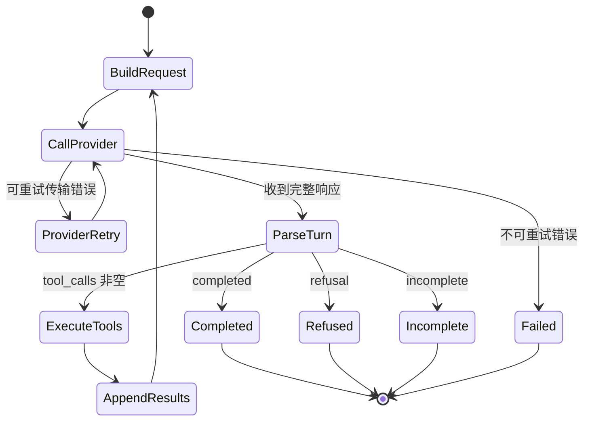

# Iteration 3：真实 LLM 与原生 Tool Calling 设计

- 状态：3A/3B Implemented，3C Proposed
- 日期：2026-07-16
- 首个 Provider：OpenAI Responses API
- 核心原则：领域协议归 Runtime 所有，SDK 类型限制在 Adapter 内部

## 1. 目标

Iteration 3 将把确定性的 `MockLLM` 扩展为第一个真实模型 Adapter，同时保持现有测试不依赖网络和 API key。

完成后应支持：

```text
用户任务
  -> Agent 构造 ModelRequest
  -> OpenAIResponsesAdapter 映射消息和工具
  -> Responses API 返回文本和零到多个 function_call item
  -> Adapter 解析为领域 ModelTurn
  -> Agent 按 call_id 执行工具
  -> function_call_output 使用同一 call_id 回传
  -> 模型继续决策或给出最终答案
```

## 2. 非目标

本轮不实现：

- LangChain Agent 或 LangGraph；
- Anthropic、Gemini、Moonshot 等第二 Provider；
- 并行工具执行；
- 会话数据库；
- 自动上下文压缩；
- 权限审批和进程沙箱；
- 后台 Responses；
- MCP 内置工具。

这些能力会影响协议设计，但不会在同一轮实现，避免无法区分 Provider、并发和持久化问题。

## 3. 已核对的外部协议事实

### 3.1 OpenAI 官方 SDK

基于 OpenAI Python SDK 提交 `f16fbbd2bd25dc1ff150b5f78dbd15ff6bab6d91` 的生成类型：

- Function Tool 包含 `type="function"`、`name`、`parameters`、`strict`，`description` 可选。
- Function Call 输出 item 的 `type` 为 `function_call`。
- 模型生成的参数是 JSON 字符串，而不是已经验证的 Python 字典。
- Function Call 同时包含 `call_id` 和可选的 item `id`；调用结果关联使用 `call_id`。
- 回传结果 item 的 `type` 为 `function_call_output`，必须携带相同 `call_id`。
- Response 的 `output` 是有序 item 数组，不能假设第一项一定是 assistant 文本。
- Response 可能是 `completed`、`incomplete` 或 failed；不完整原因至少包括输出 Token 上限和内容过滤。
- 流式函数参数通过 delta 和 done 事件传递，完成事件才包含最终 Response。

参考：

- [FunctionToolParam](https://github.com/openai/openai-python/blob/f16fbbd2bd25dc1ff150b5f78dbd15ff6bab6d91/src/openai/types/responses/function_tool_param.py)
- [ResponseFunctionToolCall](https://github.com/openai/openai-python/blob/f16fbbd2bd25dc1ff150b5f78dbd15ff6bab6d91/src/openai/types/responses/response_function_tool_call.py)
- [FunctionCallOutput](https://github.com/openai/openai-python/blob/f16fbbd2bd25dc1ff150b5f78dbd15ff6bab6d91/src/openai/types/responses/response_input_item_param.py)
- [Response](https://github.com/openai/openai-python/blob/f16fbbd2bd25dc1ff150b5f78dbd15ff6bab6d91/src/openai/types/responses/response.py)

### 3.2 OpenAI Codex

Codex 将 Provider 工具定义、可执行 ToolCall 和模型可见 ToolOutput 分开：

- ToolCall 保留 `turn_id`、`call_id`、工具名、模型和 payload。
- ToolOutput 负责使用 `call_id` 转换成 Response input item。
- 并行执行由独立 Runtime 控制，不由工具 handler 自己决定。
- 工具错误仍转换成带相同 `call_id` 的模型可见输出。

参考：

- [tool_call.rs](https://github.com/openai/codex/blob/5c19155cbd93bfa099016e7487259f61669823ff/codex-rs/tools/src/tool_call.rs)
- [tool_output.rs](https://github.com/openai/codex/blob/5c19155cbd93bfa099016e7487259f61669823ff/codex-rs/tools/src/tool_output.rs)
- [parallel.rs](https://github.com/openai/codex/blob/5c19155cbd93bfa099016e7487259f61669823ff/codex-rs/core/src/tools/parallel.rs)

### 3.3 Hermes Agent

Hermes 展示了多 Provider 的现实问题：一份标准 JSON Schema 不能直接假设所有模型后端都接受。它在最终发送前清洗 Schema，并针对 Gemini、Moonshot 等 Provider 做方言转换。

Iteration 3 只实现 OpenAI Mapper，但接口必须允许未来增加：

```text
Canonical Tool Schema
  -> OpenAI Schema Mapper
  -> Gemini Schema Mapper
  -> Moonshot Schema Mapper
```

参考：

- [schema_sanitizer.py](https://github.com/NousResearch/hermes-agent/blob/7acaff5ef2bcbaa22bd23b72efe60906123a4f55/tools/schema_sanitizer.py)
- [gemini_schema.py](https://github.com/NousResearch/hermes-agent/blob/7acaff5ef2bcbaa22bd23b72efe60906123a4f55/agent/gemini_schema.py)
- [moonshot_schema.py](https://github.com/NousResearch/hermes-agent/blob/7acaff5ef2bcbaa22bd23b72efe60906123a4f55/agent/moonshot_schema.py)

### 3.4 Gajae-Code

Gajae-Code 在 Agent Loop 内使用自己的 AgentMessage，只在 LLM 调用边界转换为 Provider Message；第三方工具结果在进入历史前统一规范化，并通过 append-only 上下文保持可回放性。

本项目采用相同边界原则，但自行实现所需最小类型，不复制其代码。

参考：

- [agent-loop.ts](https://github.com/Yeachan-Heo/gajae-code/blob/aedd0df99e7c9dff420b50f7ff47bd6645627bdd/packages/agent/src/agent-loop.ts)
- [append-only-context.ts](https://github.com/Yeachan-Heo/gajae-code/blob/aedd0df99e7c9dff420b50f7ff47bd6645627bdd/packages/agent/src/append-only-context.ts)

## 4. 3A 前的模型不足与已完成修正

3A 前的领域结构：

```python
ToolCall(name, arguments)
ToolResult(name, ok, content, error_code, details)
LLMResponse(content, tool_call, done)
```

3A 已修正前四项；Provider Adapter 的边界在 3B 实现：

1. `ToolCall` 没有稳定 `call_id`。已由 3A 修正。
2. `LLMResponse` 只能表达一个工具调用。已由 `ModelTurn.tool_calls` 修正。
3. 文本、拒绝、工具调用和不完整状态被压成一个对象。已由 `finish_reason` 修正。
4. 无法保存 Provider response id、Token 使用量和结束原因。已加入 `provider_response_id` 和 `Usage`。
5. `LLM.next()` 同时承担领域请求和 Provider 映射。3A 已提供 `generate(ModelRequest)` 边界，3B 将实现具体 Adapter。

## 5. 领域模型提案

### 5.1 ToolCall

```python
@dataclass(frozen=True)
class ToolCall:
    call_id: str
    name: str
    arguments: dict[str, Any]
```

规则：

- `call_id` 在一个 Session 中必须唯一。
- 真实 Provider 使用 Provider 提供的 `call_id`。
- `MockLLM` 使用确定性 ID，例如 `mock-call-0001`，不能依赖随机 UUID，保证测试可回放。
- JSON 参数解析失败时仍保留 `call_id`，并产生关联的 `invalid_arguments` ToolResult。

### 5.2 ToolResult

```python
@dataclass(frozen=True)
class ToolResult:
    call_id: str
    name: str
    ok: bool
    content: str
    error_code: str | None = None
    details: dict[str, Any] = field(default_factory=dict)
```

`call_id` 是协议关联键，`name` 主要用于日志和防御性检查。若结果的工具名与原调用不同，Runtime 必须拒绝写回。

### 5.3 ModelRequest

```python
@dataclass(frozen=True)
class ModelRequest:
    messages: list[Message]
    tools: list[ToolDefinition]
    max_output_tokens: int | None = None
```

后续可以增加 system instructions、reasoning 配置和 Provider-independent metadata，但本轮不提前加入未使用字段。

### 5.4 ModelTurn

```python
FinishReason = Literal[
    "completed",
    "tool_calls",
    "incomplete",
    "refusal",
]

@dataclass(frozen=True)
class Usage:
    input_tokens: int
    output_tokens: int
    total_tokens: int

@dataclass(frozen=True)
class ModelTurn:
    content: str
    tool_calls: list[ToolCall]
    finish_reason: FinishReason
    provider_response_id: str | None = None
    usage: Usage | None = None
```

不再保留容易产生矛盾的 `done` 布尔值。结束状态由 `finish_reason` 和 `tool_calls` 共同验证：

- `tool_calls` 非空时必须是 `tool_calls`；
- `completed/refusal/incomplete` 时不得同时包含待执行调用；
- Provider 返回矛盾数据时产生 `provider_protocol_error`。

## 6. Provider 接口

```python
class LLM(ABC):
    @abstractmethod
    def generate(self, request: ModelRequest) -> ModelTurn:
        ...
```

Adapter 职责：

- 把领域 Message 映射为 Provider input；
- 把 ToolDefinition 映射为 Provider Schema；
- 调用官方 SDK；
- 解析所有 output items；
- 解析工具参数 JSON；解析失败时生成仍带原 `call_id` 的 `invalid_arguments` 调用结果；
- 映射 Provider 错误；
- 返回领域 `ModelTurn`。

Adapter 不负责：

- 执行工具；
- 决定是否审批；
- 修改工作区；
- 选择错误恢复策略；
- 管理 `max_steps`。

## 7. OpenAI Responses 映射

### 7.1 工具定义

Canonical Tool：

```python
Tool(
    name="read_file",
    description="Read a UTF-8 text file from the workspace.",
    parameters={...},
)
```

映射为：

```python
{
    "type": "function",
    "name": "read_file",
    "description": "Read a UTF-8 text file from the workspace.",
    "parameters": {...},
    "strict": True,
}
```

发送前必须重新检查：

- 顶层类型是 object；
- 存在 properties；
- 所有可调用字段都有明确类型；
- `additionalProperties` 为 false；
- required 不引用不存在字段。

Runtime 的 JSON Schema 校验仍然保留。Provider strict mode 不能替代执行前校验，因为外部 Provider、缓存数据和测试 Double 都可能违反契约。

### 7.2 模型输出

Adapter 按 `response.output` 原始顺序遍历：

```text
message item       -> 累加可见文本或拒绝
function_call item -> 解析 call_id/name/arguments
reasoning item     -> 不暴露为用户文本，保留为 Provider artifact（后续）
未知 item          -> provider_protocol_error
```

不能使用 `response.output[0]` 假设文本，也不能只读一个 function call。

### 7.3 工具结果回传

每个 ToolResult 映射为：

```python
{
    "type": "function_call_output",
    "call_id": result.call_id,
    "output": result.to_observation(),
}
```

失败同样作为 output 回传，让模型决定纠参、换工具或停止。HTTP 成功不代表工具成功。

## 8. 多工具执行语义

一个 ModelTurn 可以返回：

```text
call-A: read_file(a.py)
call-B: read_file(b.py)
call-C: run_command(test)
```

Iteration 3 的规则：

1. 保留 Provider 输出顺序。
2. Runtime 逐个执行，不并行。
3. 每个调用产生一个相同 `call_id` 的 ToolResult。
4. 全部 ToolResult 写入历史后，才发起下一次模型请求。
5. 单个工具失败不阻止同一批次后续调用；策略层可以在未来改变这一规则。

暂不并行的原因：并行需要同时解决取消、审批顺序、文件写冲突、日志排序和部分失败语义。仅设置 `parallel_tool_calls=False` 不能替代 Runtime 自身的并发安全设计。

## 9. 状态机



`max_steps` 继续计算模型轮次，而不是单个工具数量。每轮允许多个 ToolCall，因此后续还需要独立的 `max_tool_calls` 预算。

## 10. Provider 错误协议

新增 Provider 级错误，不与 ToolResult 混用：

| 错误码 | 是否默认重试 | 含义 |
| --- | --- | --- |
| `provider_timeout` | 是，有限次数 | 请求或流读取超时 |
| `provider_connection_error` | 是，有限次数 | DNS、连接断开等 |
| `provider_rate_limited` | 是，遵守 Retry-After | 429 或等价限流 |
| `provider_server_error` | 是，有限次数 | Provider 5xx |
| `provider_auth_error` | 否 | API key 或权限问题 |
| `provider_bad_request` | 否 | 请求或 Schema 被拒绝 |
| `provider_protocol_error` | 否 | 响应缺字段、重复 call_id、未知必要 item |

`incomplete` 和 `refusal` 是成功收到的模型结果，不抛 Provider 异常。Adapter 分别返回 `finish_reason="incomplete"` 和 `finish_reason="refusal"`，由 Agent 形成明确的终止结果。非法工具参数 JSON 也不丢失整轮响应，而是保留 `call_id` 并生成 `invalid_arguments` ToolResult，让模型有机会纠正。

重试边界：

- 只在尚未接受完整 ModelTurn 前重试 Provider 请求。
- 不自动重试已经执行过的写文件或 Shell 工具。
- 每次重试记录 attempt、耗时和错误码。
- SDK 自带重试必须显式配置，避免 SDK 和 Runtime 双重退避。

## 11. 会话状态选择

Responses API 可以使用 Provider 侧连续状态，也可以由客户端重发历史。Iteration 3 采用分层策略：

1. mini_agent 的 Message/ToolCall/ToolResult 始终是本地事实来源。
2. Adapter 可以保存 `provider_response_id` 作为连续调用优化。
3. system/developer instructions 每次显式提供，不能假设前一 Response 自动继承。
4. Provider 特有 reasoning/output item 暂存为 Adapter artifact，不进入通用 Message 文本。
5. 后续持久化阶段再实现完全 stateless replay。

这样不会把会话真相只放在 Provider 服务器上，同时避免 Iteration 3 立即实现完整 reasoning item 重放。

## 12. 流式分阶段

### Iteration 3A：非流式核心（已完成）

- [x] 完成领域类型升级；
- [x] 实现 FakeProvider 测试 Double；
- [x] 支持多个 ToolCall；
- [x] 验证 call_id；
- [x] 重构现有 MockLLM。

### Iteration 3B：OpenAI 非流式 Adapter（已完成）

- [x] 引入官方 SDK 可选依赖；
- [x] 实现 Tool/Message/Response Mapper；
- [x] 增加 Provider 错误映射；
- [x] 增加可选 live smoke test。

### Iteration 3C：流式事件

- 增加 text delta、tool argument delta、item completed、response completed 事件；
- Adapter 内组装参数 JSON；
- Agent 只在 function call arguments done 后执行工具；
- CLI 消费领域 StreamEvent，而不是 SDK event。

先非流式是为了固定正确协议；流式只改变传输过程，不应改变最终 `ModelTurn` 语义。

## 13. CLI 与配置

目标接口：

```bash
python -m mini_agent "分析项目结构" --provider openai --model MODEL_ID
```

规则：

- 默认 Provider 仍是 `mock`，保证零配置可运行。
- API key 只从 `OPENAI_API_KEY` 或 SDK 标准认证读取，不提供 `--api-key`，避免进入 shell history。
- `--model` 必须显式提供或来自配置；本设计不硬编码“最新模型”。
- trace 不打印 API key、Authorization header 或完整敏感请求。
- live test 使用单独 marker，默认测试套件不访问网络。

## 14. 文件布局

建议实现后形成：

```text
mini_agent/
├── agent.py
├── schema.py
├── tools.py
├── providers/
│   ├── __init__.py
│   ├── base.py
│   ├── mock.py
│   └── openai_responses.py
└── provider_errors.py

tests/
├── test_agent.py
├── test_tools.py
├── test_provider_contract.py
└── test_openai_responses_adapter.py
```

`openai_responses.py` 是唯一允许 import OpenAI SDK 类型的业务模块。

## 15. 测试计划

### Contract tests

同一组测试运行在 Mock/Fake/OpenAI Adapter Double 上：

- 普通文本完成；
- 单工具调用；
- 多工具调用顺序；
- 工具失败后继续模型轮次；
- call_id 一一对应；
- 重复 call_id 被拒绝；
- 非法参数 JSON 被转成关联错误；
- incomplete/refusal 不被误判为成功。

### Mapper tests

- Tool Schema 精确快照；
- user/system/tool result 映射；
- 混合 output item 解析；
- 多个 function_call 解析；
- 未知 output item fail closed；
- Provider response id 和 usage 映射。

### Retry tests

- 超时后有限重试；
- 429 遵守测试 Double 提供的延迟，不真实 sleep；
- 认证和 bad request 不重试；
- 收到完整 ModelTurn 后不重放请求；
- Tool Executor 永不因 Provider retry 重复执行。

### Live smoke test

满足以下条件才运行：

- 显式设置 `OPENAI_API_KEY`；
- 显式传入模型；
- 显式启用 integration marker。

只验证一个无副作用工具，不写文件、不运行 Shell，并设置严格 Token 和时间上限。

## 16. 验收标准

Iteration 3 完成必须同时满足：

- `MockLLM` 原有场景继续通过；
- Agent 支持零到多个 ToolCall；
- 所有 ToolResult 带正确 call_id；
- OpenAI SDK 类型不泄漏到领域层；
- 默认测试零网络、零 API key；
- Provider 错误和 Tool 错误完全分离；
- 非流式和未来流式共享同一个最终 ModelTurn；
- 文档包含一条真实 trace 和一条失败 trace；
- 代码和文档通过提交前检查。

## 17. 开放问题

实现 3A 前需要确认：

1. `ToolCall.arguments` 是否同时保存原始 JSON 字符串用于审计；建议增加 `raw_arguments`，领域执行只使用解析后的 dict。
2. Adapter artifact 是否在本轮落盘；建议只保存在内存，Iteration 4 再随 Session 持久化。
3. 多工具批次中一个写操作失败后是否继续；本轮选择继续，Iteration 5 权限系统再引入 fail-fast policy。
4. 是否在 3B 立即开启 strict；当前工具 Schema 已满足基础要求，建议开启并保留本地二次校验。

## 18. 来源限制

本次设计首先尝试使用 OpenAI Docs MCP，但当前会话没有暴露已安装的 MCP 工具；直接访问 `developers.openai.com` 返回 403，`platform.openai.com` 在当前网络下超时。因此 OpenAI 协议字段以官方 Python SDK 的生成类型和官方 Codex 源码为依据。

应用重启并恢复 Docs MCP 后，实施 3B 前必须重新核对 Function Calling、Conversation State、Streaming Responses 和 API Reference；若官方文档与本设计冲突，以官方文档为准并更新本文件。
