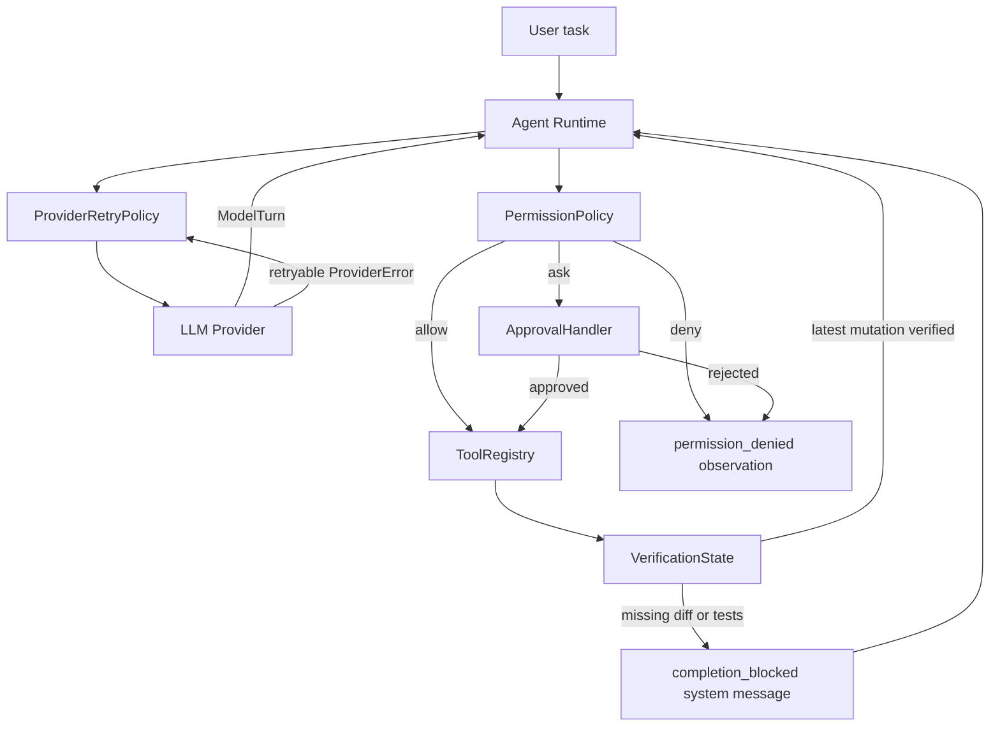

# Iteration 4：安全执行闭环

Iteration 3B 解决了“如何接入真实模型”，本轮解决的是更关键的问题：模型开始修改代码后，Runtime 如何避免重复副作用、未授权修改和未经验证的完成声明。

这不是单纯的安全加固。Coding Agent 的准确度很大程度上取决于执行协议是否能阻止三类假成功：

1. Provider 请求失败后重放了已经发生的工具副作用。
2. 模型根据过期内容修改文件，覆盖了用户或其他进程的新改动。
3. 模型修改后直接声称完成，没有检查实际 diff 和测试结果。

## 1. 生产闭环



边界必须保持清晰：`ProviderRetryPolicy` 包围模型请求，而不包围 Agent Loop 或工具执行。这样超时、限流和临时服务错误只会重新请求尚未形成完整 `ModelTurn` 的模型调用。

## 2. Provider 重试边界

`ProviderRetryPolicy` 只重试 `LLM.generate(request)`：

- `ProviderTimeoutError`、连接错误、限流和服务端错误可重试。
- 鉴权、坏请求和协议错误直接失败。
- 优先尊重 Provider 的 `Retry-After`，否则使用有上限的指数退避。
- `sleeper` 可以注入，测试不需要真实等待。

假设第一轮模型要求执行 `apply_patch`，工具成功后第二轮模型请求超时。Runtime 只重试第二轮模型请求；第一轮 Patch 已经在消息历史中，不会再次执行。

## 3. 权限决策与能力最小化

每个 `Tool` 有两个与执行控制相关的元数据：

| 字段 | 值 | 作用 |
| --- | --- | --- |
| `permission` | `read` / `write` / `execute` | 决定自动允许、询问或拒绝 |
| `effect` | `none` / `workspace_mutation` / `diff_check` / `test_check` | 驱动修改后的验证状态 |

三种 Policy：

| 模式 | 读取 | 写入 | 进程执行 |
| --- | --- | --- | --- |
| `read-only` | allow | deny | deny |
| `on-request` | allow | ask | ask |
| `full` | allow | allow | allow |

Policy 在 handler 之前执行。拒绝和未批准都会产生带稳定错误码的 `ToolResult(error_code="permission_denied")`，因此模型能看到失败并调整计划，同时副作用尚未发生。

Policy 不是唯一防线。真实 Provider 使用 `create_coding_registry()`，根本不向模型暴露整文件 `write_file` 和任意 Shell `run_command`。这是 capability minimization：既限制模型能看见什么，也限制 Runtime 最终能执行什么。

## 4. 受控局部修改

`apply_patch` 不接受完整文件内容，而是要求：

- 工作区内的相对路径；
- 当前文件中唯一出现的 `old_text`；
- 替换用的 `new_text`；
- 最近一次 `get_file_stats` 返回的 `expected_sha256`。

执行顺序：

```text
resolve workspace path
  -> read current bytes
  -> compare SHA-256
  -> require exactly one old_text match
  -> write one replacement
  -> return before/after SHA-256
```

稳定失败码：

- `stale_file`：读取后文件发生变化，模型必须重新观察。
- `patch_conflict`：目标文本不存在。
- `ambiguous_patch`：目标文本出现多次，需要提供更多上下文。
- `patch_no_change`：新旧文本相同。
- `path_escape`：路径越过工作区。

哈希前置条件是乐观并发控制。它不能替代操作系统级原子写入，但能显著降低模型基于陈旧上下文覆盖新内容的概率。

## 5. 受限测试执行

`run_tests` 固定执行：

```text
python -m pytest -q <targets>
```

它使用 argv 与 `shell=False`，并拒绝：

- 以 `-` 开头的 pytest 参数，防止模型改变 Runtime 规定的执行方式；
- NUL 字符；
- 路径部分越过工作区的测试 target 或 node ID。

它仍然属于 `execute` 权限，因为测试代码本身是可执行代码。`on-request` 模式下必须经过审批。

## 6. 完成验证守卫

`VerificationState` 使用单调版本号跟踪最新成功修改：

```text
successful mutation -> mutation_version += 1
successful git_diff -> diff_version = mutation_version
successful run_tests -> tests_version = mutation_version
```

当模型返回 `finish_reason="completed"` 时，只要最新修改没有同时满足：

```text
diff_version == mutation_version
tests_version == mutation_version
```

Runtime 就追加结构化 `completion_blocked` system message 并继续下一轮。任何后续修改都会推进 `mutation_version`，之前的 diff 和测试立即失效。

`refusal` 与 `incomplete` 不会被守卫改写为成功或无限重试。它们描述 Provider 的真实结束状态，应原样交给上层。

## 7. 测试合同

本轮测试覆盖：

- `Retry-After`、指数退避上限和不可重试错误；
- Provider 重试不重复执行已完成工具；
- deny / ask-reject / ask-approve / full 权限行为；
- 未批准 Patch 不修改文件；
- Patch 成功、陈旧哈希、缺失匹配和重复匹配；
- pytest 参数与工作区逃逸拒绝；
- coding registry 不包含任意 Shell 和整文件覆盖；
- 修改后过早完成被阻断，diff 与测试成功后才允许完成；
- `refusal` 和 `incomplete` 保持原语义。

默认测试不访问真实 Provider。OpenAI live test 仍然显式 opt-in。

## 8. 当前边界与下一步

当前实现已经建立正确的最小语义，但还不是完整沙箱：

- `apply_patch` 的检查与写入之间没有文件锁或原子 compare-and-swap。
- `run_tests` 能限制启动参数，但 pytest 执行的项目代码仍拥有宿主进程权限。
- CLI 审批是同步终端输入，没有持久化审批记录和可恢复会话。
- `git_diff`、测试输出和消息历史只有长度截断，没有统一 artifact 存储。

上述 execution journal 已在 [Iteration 5A](iteration-5a-execution-journal.md) 实现。下一步是在事件元数据之上增加消息快照、Artifact Store 和显式恢复状态机。
