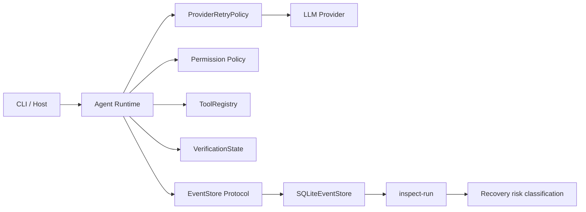

# Iteration 5A：Execution Journal

Iteration 4 保证一次仍在运行的 Agent 不会盲目重试工具、越权修改或跳过验证。但所有执行状态仍在内存里：进程终止后，宿主无法区分“工具尚未开始”和“工具已经产生副作用，只是结果没来得及记录”。

Iteration 5A 增加 append-only Execution Journal。目标不是立即自动恢复，而是先建立可靠事实：发生了什么、顺序是什么、哪些副作用结果仍不确定。

## 1. 架构位置



`Agent` 只依赖 `EventStore` Protocol，不依赖 SQLite API。SQLite 是当前宿主实现，未来服务端可以替换成 PostgreSQL、远端事件服务或测试 Double，而不改变 Runtime 的执行语义。

## 2. RunEvent Schema

持久化事件结构：

```text
event_id       全局唯一事件 ID
run_id         一次 Agent.run() 的关联 ID
sequence       run 内从 1 开始的严格顺序
event_type     稳定事件类型
schema_version 当前为 1
created_at     UTC ISO-8601 时间
payload        经过校验和清理的 JSON object
```

当前事件类型：

| 阶段 | 事件 |
| --- | --- |
| Run | `run_started`, `run_completed`, `run_failed` |
| Provider | `model_request_started`, `model_request_failed`, `model_request_completed` |
| Permission | `permission_decided` |
| Tool | `tool_execution_started`, `tool_execution_completed`, `tool_execution_skipped` |
| Verification | `verification_updated`, `completion_blocked` |

`SQLiteEventStore.append()` 在运行时校验事件类型和必填 payload key。Python `Literal` 只提供静态提示，不能阻止插件在运行时写入畸形事件，因此校验必须发生在持久化边界。

## 3. 顺序与事务

表 `run_events` 使用：

```text
PRIMARY KEY (event_id)
UNIQUE (run_id, sequence)
INDEX (run_id, sequence)
```

每次 append 使用同一事务完成：

```text
BEGIN IMMEDIATE
  -> SELECT MAX(sequence) + 1 for run_id
  -> INSERT event
COMMIT
```

实例内部还有线程锁，SQLite 使用 WAL 与 `synchronous=FULL`。这保证共享同一 Store 实例的多个线程不会给同一 run 分配重复 sequence，并且进程崩溃后只会看到完整提交的事件。

当前实现定位是单进程 Runtime。跨进程高并发应使用数据库原生 sequence/locking 设计，而不是继续扩展当前的 `MAX(sequence) + 1`。

## 4. 副作用边界

允许执行的工具遵循严格顺序：

```text
permission_decided persisted
  -> tool_execution_started persisted
  -> handler executes
  -> tool_execution_completed persisted
```

这个顺序形成两个重要保证：

1. 如果写入 `tool_execution_started` 失败，handler 不会执行，因此没有未记录副作用。
2. 如果 handler 成功后写入 completed 失败，started 仍然存在，恢复检查会保守地报告结果未知。

权限拒绝、审批拒绝和未知工具不会写入 started，而是写入 `tool_execution_skipped`。它们没有执行 handler，不应被误判为中断副作用。

## 5. Provider 尝试

一次 Agent step 对应一个稳定 `request_id`。Journal 会记录：

- 请求开始时的消息数量和工具数量；
- 每次失败的 attempt、稳定错误码、是否继续重试和退避时间；
- 最终成功 attempt、finish reason、Provider response ID、tool call 关联和 usage。

Journal 不包围工具执行，也不会改变 Iteration 4 的重试边界。Provider 第二次尝试仍然只重放模型请求，不重放之前已经完成的 ToolCall。

## 6. 内容最小化与脱敏

Journal 默认不保存：

- 原始用户任务和 system prompt；
- 模型正文；
- `old_text`、`new_text` 或完整工具参数；
- 文件内容、diff、测试输出和最终答案正文；
- Provider 请求 Header。

正文使用以下摘要代替：

```json
{
  "characters": 120,
  "bytes": 136,
  "sha256": "..."
}
```

工具参数只记录 key、目标路径或测试 target，以及完整参数 JSON 的摘要。存储边界还会递归清理 `authorization`、`api_key`、`access_token`、`password`、cookie 等常见敏感字段，并处理 Bearer 和 OpenAI key 形态。

这不是完整 DLP。任意自然语言中都可能包含未知形式的秘密，因此生产系统仍应默认最小化内容，并把确实需要恢复的正文交给独立、加密、可设置保留期的 Artifact Store。

## 7. 中断检查

CLI 普通运行输出：

```text
[run_id]
run-...
```

检查时间线：

```powershell
python -m mini_agent --inspect-run run-...
```

`inspect_run()` 查找只有 `tool_execution_started`、没有相同 `call_id` completed 的执行：

| 工具属性 | disposition | 5B 恢复策略 |
| --- | --- | --- |
| `permission=read` 且非 mutation | `safe_to_retry` | 可以重新读取 |
| `write`、`execute` 或 mutation | `unknown_outcome` | 禁止自动重放，先检查或审批 |

Run 状态：

- 存在 `run_completed`：`completed`
- 存在 `run_failed`：`failed`
- 两者都不存在：`interrupted`

## 8. 当前限制

5A 有意不实现 `resume-run`，原因是元数据事件不足以重新构造完整 Provider 消息历史。自动恢复至少还需要：

- 版本化 Message Snapshot；
- 大正文和工具证据的 Artifact Store；
- ToolCall 幂等索引；
- started-only 写操作的 reconcile 流程；
- 工作区 identity 与 Git revision 校验；
- 恢复前重新执行 Permission Policy。

因此 5A 的准确表述是“可持久化审计并识别恢复风险”，不是“已经可以安全自动恢复”。

## 9. 测试合同

测试覆盖：

- SQLite 关闭、重开后的事件顺序；
- 未知事件和缺失必填字段拒绝；
- 敏感 key、Bearer token 和 key 形态清理；
- 原始任务和工具输出不进入 Journal；
- Provider attempt 记录；
- started 持久化失败时 handler 不执行；
- started-only 读取与写入的不同恢复分类；
- CLI 生成 run_id 并回读完整时间线。

下一阶段 Iteration 5B 将增加 Message Snapshot、Artifact Store 和显式 `resume-run` 状态机，继续保持“未知副作用永不自动重放”这一核心原则。
