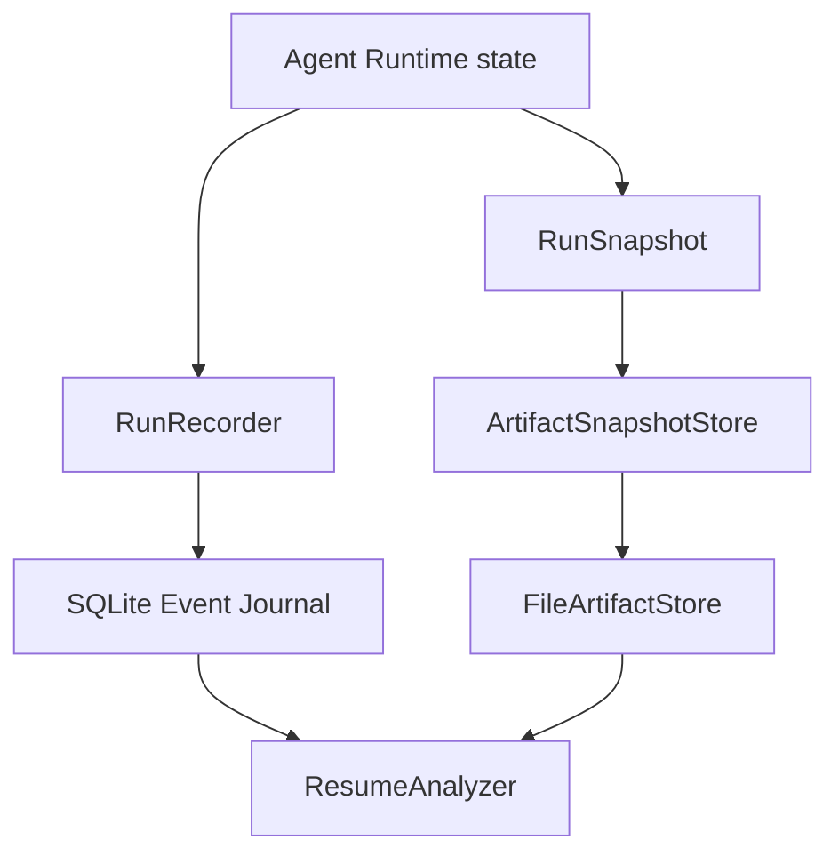

# Iteration 5B1：可恢复会话的数据基础

Iteration 5A 能记录执行事件，但事件中的正文和消息历史只保存摘要。进程中断后，系统知道“某个工具开始过”，却不一定拥有重新请求模型所需的完整上下文。

本轮先实现恢复的数据基础，不直接执行恢复：

```text
Event Journal
  + Artifact Store
  + Versioned Run Snapshot
  -> Resume Analyzer
  -> recovery decision only
```

核心原则：**分析器可以拒绝恢复，但不能替用户猜测未知副作用已经发生或没有发生。**

## 1. 本轮目标与非目标

### 已实现

- 内容寻址 `FileArtifactStore`；
- SHA-256 完整性校验和内容去重；
- 原子临时文件写入；
- `RunSnapshot` 版本化 Schema；
- `Message`、`ToolCall` 的 JSON 序列化往返；
- Agent 默认保存初始、tool batch、批次完成和完成提交前快照；
- 快照 Artifact 与 Journal `snapshot_saved` 事件关联；
- `ResumeAnalyzer` 只读检查；
- CLI `--analyze-resume RUN_ID`。

### 明确不实现

- 不调用 Provider；
- 不执行任何 Tool；
- 不实现 `--resume-run`；
- 不自动重放 started-only Patch、Shell 或测试；
- 不协调未知副作用；
- 不保存 API Header、环境变量、完整 Patch 或完整工具输出到 Journal。

## 2. 三层持久化模型



| 层 | 保存内容 | 作用 |
| --- | --- | --- |
| Event Journal | 事件顺序、错误码、权限、调用关联、摘要 | 证明发生过什么 |
| Artifact Store | 完整 Snapshot 或未来的 diff/测试正文 | 保存可恢复证据 |
| RunSnapshot | 消息、调用 ID、验证状态、运行配置和指纹 | 重建下一轮 Runtime 状态 |

三者不是重复存储：Journal 适合追加审计，Artifact 适合大内容，Snapshot 适合状态恢复。

## 3. 内容寻址 Artifact Store

默认目录：

```text
.mini_agent/
  runs.db
  artifacts/
    ab/
      abcdef...  # 完整 SHA-256 文件名
```

`FileArtifactStore.put(content, media_type)` 会计算内容 SHA-256，以完整摘要作为 `artifact_id`，使用临时文件、`fsync` 和原子替换写入；相同内容自动复用已有文件。

读取时会重新计算 SHA-256 和字节数。文件被手工修改或损坏时，`get()` 抛出完整性错误，分析器把 Snapshot 标记为不可用。

## 4. RunSnapshot

当前 Snapshot 包含：

```text
run_id
snapshot_version
last_event_sequence
next_step
resume_point
messages
seen_call_ids
verification
max_steps
require_verification
llm_identity
tool_schema_sha256
workspace.root
workspace.git_head
workspace.state_sha256
```

`resume_point` 描述崩溃窗口：

| 值 | 含义 |
| --- | --- |
| `model_request` | 可以从下一轮模型请求继续分析 |
| `tool_batch` | 模型已返回完整 ToolCall，工具尚未开始；Snapshot 包含调用参数 |
| `run_completion` | 最终答案已形成，但 `run_completed` 事件尚未提交 |

## 5. 快照保存顺序

初始状态：

```text
run_started
snapshot_saved(resume_point=model_request)
```

Provider 返回工具调用后：

```text
model_request_completed
snapshot_saved(resume_point=tool_batch)
permission_decided
tool_execution_started
tool_execution_completed
...
snapshot_saved(resume_point=model_request)
```

先保存 `tool_batch` 快照，再执行 handler。正常完成则先保存 `run_completion` 快照，再写入 `run_completed`。如果完成事件没有写入，分析器报告 `completion_commit_incomplete`。

## 6. 工作区与工具指纹

Snapshot 保存绝对 workspace root、Git `HEAD`、workspace 内容树 SHA-256、工具名称/描述/参数/permission/effect 指纹，以及 LLM 类和模型 ID。

恢复分析时重新计算：

| 变化 | 结果 |
| --- | --- |
| workspace root | `workspace_root_changed`，阻断 |
| Git HEAD | `git_head_changed`，阻断 |
| 文件内容树 | `workspace_state_changed`，阻断 |
| Tool Schema/权限/effect | `tool_schema_changed`，阻断 |
| Provider/model identity | `llm_identity_changed`，阻断 |

Journal 和 Artifact 目录会从 workspace 内容指纹中排除，避免日志自身写入导致恢复失败。

## 7. ResumeAnalyzer 决策

```powershell
python -m mini_agent --analyze-resume RUN_ID
python -m mini_agent --provider openai --model MODEL_ID --analyze-resume RUN_ID
```

分析时必须选择原运行相同的 Provider、模型和工具注册表。默认命令使用 Mock 配置；如果原运行使用 OpenAI，必须显式传入当时的 `--model`。当前 CLI 不会从 Snapshot 自动切换配置，配置不一致会得到 `llm_identity_changed` 或 `tool_schema_changed`，这是保守阻断而不是数据损坏。

返回四种决策：

| 决策 | 含义 |
| --- | --- |
| `resume_allowed` | 数据基础一致，没有未知副作用，可以进入 5B2 的只读恢复范围 |
| `already_completed` | 已存在 `run_completed`，禁止重复运行 |
| `manual_reconciliation_required` | 存在 started-only write/execute/mutation，需要人工协调 |
| `resume_blocked` | Snapshot、Artifact、指纹或事件序列不一致 |

分析器只读取 EventStore 和 SnapshotStore。它不会请求 Provider，也不会执行工具。

## 8. 关键一致性检查

每个 `snapshot_saved` 的 `last_event_sequence` 必须等于该事件 sequence 减一。Artifact 读取必须验证 `artifact_id == sha256`、内容摘要和字节数。Snapshot 之后出现未被快照覆盖的 `model_request_completed` 或 `tool_execution_completed` 时，分析器报告 `unsnapshotted_model_turn` 或 `unsnapshotted_tool_result`。

started-only 的 read 工具可以进入未来只读恢复范围；started-only 的 write、execute 或 mutation 一律要求人工协调。

## 9. 验证

```powershell
python -m pytest -q tests/test_resume_foundation.py
python -m pytest -q
```

测试覆盖 Artifact 去重/损坏、Snapshot 序列化、Agent 快照保存、恢复决策、Schema 变化阻断和分析器无副作用。

## 10. 下一步 5B2

5B2 才实现极小范围的 `resume-run`：只恢复 `resume_allowed`，复用 Snapshot 中已有消息和已完成 ToolResult，started-only read 经过重新权限判断后才允许执行；write、execute、mutation 仍然阻断。

任意 Patch、Shell 或测试的未知结果协调属于后续专门迭代，不能因为有 Snapshot 就默认安全。
