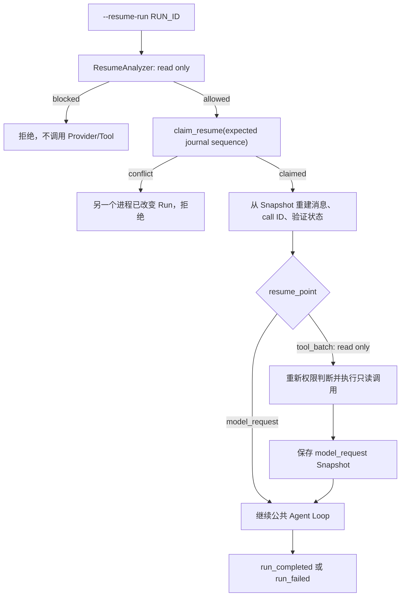

# Iteration 5B2：只恢复无未知副作用的运行

5B1 已经能保存完整 Runtime Snapshot 并判断恢复前提。5B2 增加显式 `resume-run`，但恢复范围刻意保持很小：只在所有持久化事实一致时继续模型请求，或重新执行 started-only 的只读工具；write、execute、workspace mutation 的未知结果永不自动重放。

## 1. 目标与非目标

本轮实现：

- `ResumeExecutor`：分析通过后才进入执行；
- `Agent._resume_from_snapshot()`：从已验证 Snapshot 重建内存状态；
- `run_resumed` Journal 事件；
- EventStore 原子 `claim_resume(expected_sequence)`；
- `model_request` 恢复点继续请求 Provider；
- `tool_batch` 恢复点只执行 read、非 mutation 工具；
- 恢复工具重新经过当前 Permission Policy；
- 原 `run_id`、消息、call ID、验证状态和 step 延续；
- CLI `--resume-run RUN_ID`；
- LLM、Tool Schema、Permission Policy、max steps、验证策略和 workspace 一致性检查。

本轮不实现：

- write、execute、mutation 未知结果自动协调；
- 自动提交、回滚或猜测 Patch 是否成功；
- 跨工作区或 Git revision 恢复；
- 自动选择原 Provider、模型或审批模式；
- 分布式租约、心跳和跨主机故障转移；
- 对 Snapshot 正文加密。

## 2. 四段式恢复状态机



分析与执行之间必须有原子 claim。只有“分析通过”仍不够：如果两个进程同时读取相同 Journal，它们都可能认为可以恢复。`claim_resume()` 在 SQLite `BEGIN IMMEDIATE` 事务里再次比较最后 sequence，匹配才追加 `run_resumed`。第一个进程成功后 sequence 改变，第二个进程在任何 Provider 或 Tool 调用前失败。

## 3. 两类允许的恢复点

### 3.1 `model_request`

Snapshot 已包含上一批完整 ToolResult，或运行尚未发出第一次请求。Runtime 复用持久化消息，直接从 `next_step` 创建新的 Provider 请求。

它不会重新请求 Snapshot 之前已经完成的模型轮次，也不会重新执行已有 ToolResult。请求 ID 加入当前 Journal sequence，避免同一步在恢复后与旧请求使用相同审计标识。

### 3.2 `tool_batch`

Snapshot 最后一条 assistant 消息保存完整 ToolCall，但工具可能尚未开始，也可能只留下 started 事件。只有满足以下条件才允许恢复：

```text
工具仍存在
permission == read
effect != workspace_mutation
Snapshot 后没有 completed/skipped 结果
不存在其他阻断项
```

恢复时再次调用 Permission Policy。即使它在中断前已经被允许，也不能复用旧权限决定，因为策略、宿主或运行环境可能变化。

started-only read 会重新执行，因此读取结果可能与中断前不同；workspace 内容指纹检查确保恢复开始时工作区仍与 Snapshot 一致。读取完成后，新 observation 写入消息历史，再保存新的 `model_request` Snapshot。

## 4. 为什么 completed/skipped 尾部都阻断

Journal 为了安全只保存 ToolResult 的摘要，而不是完整正文。若 Snapshot 后存在：

```text
tool_execution_completed
tool_execution_skipped
```

说明某个结果已经形成，但还没有进入最新 Snapshot。Runtime 无法仅凭 SHA-256 摘要重建下一轮模型需要的 observation，因此报告 `unsnapshotted_tool_result`，不能重复执行或编造结果。

同理，Snapshot 后的 `model_request_completed` 表示完整 ModelTurn 没有被快照覆盖，报告 `unsnapshotted_model_turn`。

## 5. 配置兼容性

自动恢复比只读分析要求更严格。Snapshot 必须匹配：

| 配置 | 不匹配时的 blocker |
| --- | --- |
| Provider/模型 identity | `llm_identity_changed` |
| 工具名称、Schema、permission、effect | `tool_schema_changed` |
| Permission Policy 类 | `permission_policy_changed` |
| 旧快照缺少 Permission Policy | `permission_policy_unknown` |
| `max_steps` | `max_steps_changed` |
| 完成验证策略 | `verification_policy_changed` |
| workspace root/Git HEAD/内容树 | 对应 workspace blocker |

5B1 生成的旧 Snapshot 没有 Permission Policy identity。它们仍可读取和审计，但 5B2 不会自动执行，避免旧 `on-request` 运行被新的 `full` 策略恢复。

## 6. CLI

Mock 运行：

```powershell
python -m mini_agent --analyze-resume RUN_ID --approval-mode full
python -m mini_agent --resume-run RUN_ID --approval-mode full
```

OpenAI 运行：

```powershell
python -m mini_agent --provider openai --model MODEL_ID --approval-mode on-request --analyze-resume RUN_ID
python -m mini_agent --provider openai --model MODEL_ID --approval-mode on-request --resume-run RUN_ID
```

Provider、模型和审批模式必须与原运行一致。命令不会从 Snapshot 自动切换配置。恢复被拒绝时 CLI 输出机器可读 `ResumeAnalysis` 并以状态码 2 退出；Provider 或存储故障使用状态码 1。

## 7. 事件时间线

从 `model_request` 恢复：

```text
... old events
snapshot_saved
run_resumed
model_request_started
model_request_completed
snapshot_saved(resume_point=run_completion)
run_completed
```

从只读 `tool_batch` 恢复：

```text
... model_request_completed
snapshot_saved(resume_point=tool_batch)
[optional old tool_execution_started without result]
run_resumed
permission_decided
tool_execution_started
tool_execution_completed
snapshot_saved(resume_point=model_request)
model_request_started
...
```

取得 claim 后发生 Runtime 异常会追加 `run_failed`。claim 冲突发生在执行权取得之前，不会给另一个恢复进程追加失败事件。

## 8. 测试

```powershell
python -m pytest -q tests/test_resume_execution.py
python -m pytest -q
```

测试覆盖：消息历史复用、原 run ID、只读 tool batch、started-only read、安全阻断、Permission Policy 变化、未快照结果、completed Run、原子 claim 和 CLI 端到端恢复。

## 9. 后续 5B3

5B3 已在 [`iteration-5b3-patch-reconciliation.md`](iteration-5b3-patch-reconciliation.md) 中实现受控 Patch 的显式 reconciliation：记录 before/after hash 和目标文件，恢复时只读检查当前文件状态，区分“确定未执行”“确定已执行”“无法判断”。

任意 Shell、外部 API、数据库或测试进程的效果通常无法仅靠 workspace hash 判断，仍需要工具级幂等键、外部状态查询或人工处理。
