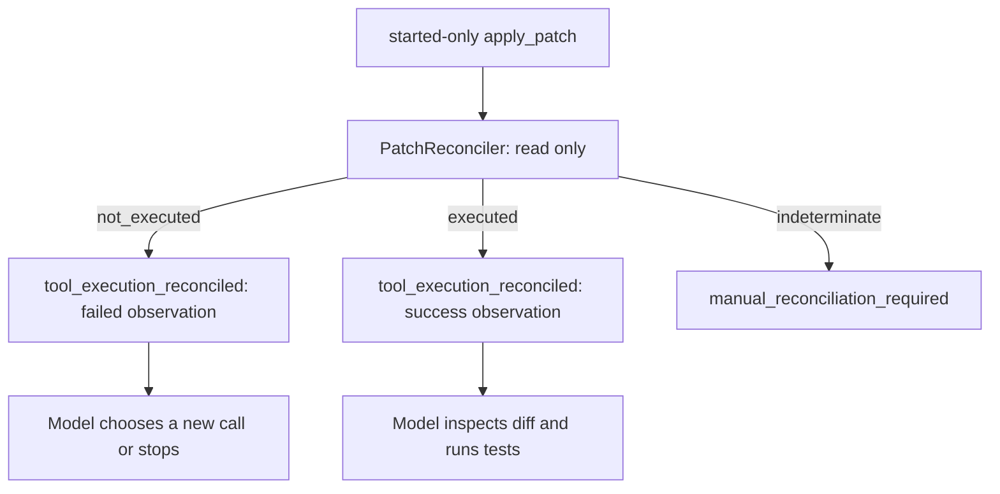

# Iteration 5B3：受控 Patch 的未知副作用协调

5B2 能恢复没有未知副作用的运行，但 started-only `apply_patch` 仍会被阻断：进程可能恰好在文件写入后、`tool_execution_completed` 写入前中断。5B3 为一个非常窄的 Patch 形态增加只读 reconciliation，区分“确定未执行”“确定已执行”和“无法判断”。

核心限制没有改变：**协调不是重放。** 系统不会自动再次执行旧 Patch。

## 1. 支持范围

只支持默认 registry 中的 `apply_patch`，且必须同时满足：

```text
目标文件存在且位于 workspace 内
expected_sha256 等于当前 before 文件 hash
old_text 恰好出现一次
old_text != new_text
```

开始 handler 前，Runtime 向 `tool_execution_started` 写入以下不含正文的证据：

| 字段 | 作用 |
| --- | --- |
| `kind=exact_file_patch_v1` | 版本化协调合同 |
| `path` | 受控 workspace 相对路径 |
| `before_sha256` / `after_sha256` | 单文件的前后字节状态 |
| `workspace_before_sha256` | 动作前完整工作区内容树 |
| `workspace_after_sha256` | 在内存中只替换该文件后的完整内容树 |

`old_text`、`new_text`、源文件正文和完整 diff 不进入 Journal。事件仍通过 Journal 的敏感字段清理边界。

## 2. 为什么需要 workspace hash

只检查目标文件会产生错误结论：文件可能恰好变成预期 after 内容，但同时另一个文件被用户或并发任务改动。恢复时模型看到的工作区已不是原 Patch 的确定结果。

因此 reconciliation 同时要求文件 hash 和完整 workspace 内容树 hash 都匹配：

```text
current file == before   and current workspace == workspace_before
  -> not_executed

current file == after    and current workspace == workspace_after
  -> executed

otherwise
  -> indeterminate
```

Git metadata、Journal、Artifact、缓存和虚拟环境目录不会进入内容树摘要，因此 Runtime 自身追加日志不会改变结论。

## 3. 命令与输出

只读检查：

```powershell
python -m mini_agent --reconcile-run RUN_ID
python -m mini_agent --journal-path .mini_agent/runs.db --reconcile-run RUN_ID
```

输出为 JSON 数组。每项包含 `call_id`、状态、原因、当前/预期文件 hash 与当前/预期 workspace hash。该命令不请求 Provider、不执行 Tool、不写入 Journal。

示例状态：

| 状态 | 含义 | 5B3 行为 |
| --- | --- | --- |
| `not_executed` | 当前工作区精确匹配 Patch 前状态 | 写入失败 reconciliation observation，不重放旧 call |
| `executed` | 当前工作区精确匹配 Patch 后状态 | 写入成功 reconciliation observation，要求后续 diff/test 验证 |
| `indeterminate` | 缺证据、文件缺失、或存在任意状态漂移 | 保持 `manual_reconciliation_required` |

## 4. 将确定结论接入恢复

对于 `tool_batch` 中 started-only 的 `apply_patch`：



`tool_execution_reconciled` 会关闭 Journal 中对应的 started-only 调用，但记录的不是伪造 `tool_execution_completed`。这保留了“handler 当时没有可验证结果”的事实，同时为后续模型请求提供真实、结构化的协调结论。

`executed` 仅在当前完整 workspace 精确匹配该 Patch 的预期 after state 时，允许把 Snapshot 的 before-state workspace 指纹视为已协调。root、Git HEAD、Provider、Tool Schema、Permission Policy、步数和验证策略仍必须匹配。任何额外变更仍阻断恢复。

## 5. 不自动重放的原因

`not_executed` 虽然证明这一次 Patch 没有发生，但不证明在恢复时继续应用它仍然合理。权限可能改变，用户可能改变目标，模型也可能先要求重新读取文件。因此系统只返回一个带 `reconciled_not_executed` 错误码的 ToolResult；若模型仍要修改，它必须生成新的 call ID，并重新走当前权限、哈希和 Journal 边界。

`executed` 也不能跳过完成验证。协调成功 ToolResult 会让 `VerificationState` 认定 workspace 已修改，完成守卫仍要求最新 diff 和测试。

## 6. 不支持的副作用

以下工具仍不会自动协调：

- 任意 Shell / `run_command`；
- `run_tests` 进程；
- 网络、数据库、队列、支付等外部系统；
- 未提供 `exact_file_patch_v1` 证据的旧 Patch；
- 多文件 Patch、二进制 Patch、非唯一文本替换。

它们需要工具级幂等键、外部查询合同、事务/补偿机制或人工确认。不能从单个 workspace hash 推断其真实世界效果。

## 7. 测试

```powershell
python -m pytest -q tests/test_resume_execution.py
python -m pytest -q
```

覆盖点包括：before/after/drift 三态、缺失证据、Shell 忽略、正常 Agent 的证据记录、CLI 只读检查、已执行/未执行 Patch 恢复 observation，以及不重放旧 Patch。

## 8. 下一步

后续 Iteration 6 应将 reconciliation 抽象为工具声明的一部分：每个有副作用工具需要显式定义是否可协调、证据 Schema、状态查询、幂等键、补偿和人工确认路径。恢复引擎不应根据工具名猜测外部效果。
